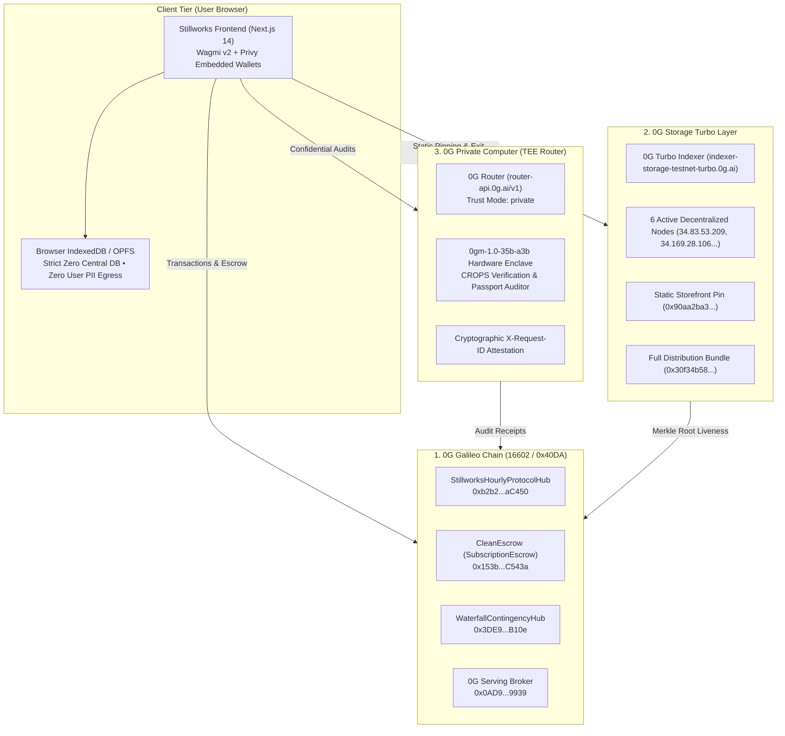

# Stillworks

> **The sovereign CROPS storefront with automated escrow rails, 0G Private Computer TEE audits, and takedown-proof walkaway recovery.**  
> Built for **ETHGlobal Mumbai 2026** (From Scratch).  
>
> 🌐 **Live Interactive App (Web):** [https://stillworks.vercel.app](https://stillworks.vercel.app)  
> 🎙️ **Live 2-Minute Pitch Deck (Live Contracts HUD):** [https://stillworks.vercel.app/pitch](https://stillworks.vercel.app/pitch)  
> 📦 **0G Storage Turbo Verified Storefront:** [https://indexer-storage-testnet-turbo.0g.ai/file?root=0x90aa2ba31e38cac3d6e87c138a4921c250ad59c0e452deea71a6546997dab294](https://indexer-storage-testnet-turbo.0g.ai/file?root=0x90aa2ba31e38cac3d6e87c138a4921c250ad59c0e452deea71a6546997dab294)  
> 🗜️ **0G Storage Turbo Full Offline Bundle (ZIP):** [https://indexer-storage-testnet-turbo.0g.ai/file?root=0x30f34b5845c2d713158a39f352947a6bc12db7b05a56485c4752e148697947d6](https://indexer-storage-testnet-turbo.0g.ai/file?root=0x30f34b5845c2d713158a39f352947a6bc12db7b05a56485c4752e148697947d6)  
> 📄 **Official Submission Pack:** [SUBMISSION.md](SUBMISSION.md) | **Onchain Flow Tx:** [`0x40df685dee5d04cf8d08a98a629d74c7fe6fd7e618ffde4f3c74138afa17c77b`](https://chainscan-galileo.0g.ai/tx/0x40df685dee5d04cf8d08a98a629d74c7fe6fd7e618ffde4f3c74138afa17c77b)

> [!NOTE]
> **0G Storage Turbo Endpoint Notice:** 0G Storage Turbo indexers serve raw pinned files with `Content-Disposition: attachment; filename="<merkle_root>"`. Direct browser visits download the raw verified cryptographic artifact. For live interactive evaluation in a browser, use the deployed web client at [https://stillworks.vercel.app](https://stillworks.vercel.app) or run locally (`npm run dev`).

---

## 🏆 ETHGlobal Mumbai Prize Tracks

### 1. 0G — Build with 0G & 0G Private Computer ($15,000 Total / $5,000 Track)
- **Applicability:** Stillworks natively integrates the full decentralized 0G stack: **0G Galileo testnet** (16602) for non-custodial subscription escrow and hourly liveness heartbeats; **0G Storage Turbo** for immutable frontend distribution and client-encrypted walkaway snapshots; and **0G Private Computer (TEE Enclaves)** for hardware-sealed CROPS passport audits using `0gm-1.0-35b-a3b` with cryptographic request ID attestations. Plus daily **iAI token** compute credit integration.
- **Key Code Links:** [`scripts/test-inference-pipeline.mjs`](scripts/test-inference-pipeline.mjs) · [`scripts/upload-site-to-0g.mjs`](scripts/upload-site-to-0g.mjs) · [`app/src/lib/zerog/storage.ts`](app/src/lib/zerog/storage.ts) · [`app/src/lib/zerog/broker.ts`](app/src/lib/zerog/broker.ts)
- **Live Links:** [Interactive App](https://stillworks.vercel.app) · [Storefront Root on 0G Storage](https://indexer-storage-testnet-turbo.0g.ai/file?root=0x90aa2ba31e38cac3d6e87c138a4921c250ad59c0e452deea71a6546997dab294)

### 2. Ethereum Foundation — Best CROPS App ($15,000 Pool / $3,500 Track)
- **Applicability:** Direct implementation of the Ethereum Foundation CROPS mandate (`blog.ethereum.org/2026/03/13/ef-mandate`). Features strict client-side privacy with **zero central database**, autonomous EVM smart contract escrow rails guaranteeing **100% pro-rata refunds upon missed founder heartbeats**, and wallet-encrypted walkaway snapshots that users can run offline via Docker compose with zero vendor lock-in.
- **Key Code Links:** [`contracts/src/SubscriptionEscrow.sol`](contracts/src/SubscriptionEscrow.sol) · [`contracts/src/StillworksHourlyProtocolHub.sol`](contracts/src/StillworksHourlyProtocolHub.sol) · [`app/src/lib/walkaway.ts`](app/src/lib/walkaway.ts)

---

## 🌟 Overview & Mission

SaaS lock-in is a systemic threat to software sovereignty. When centralized subscription platforms hike prices, terminate accounts, or sunset tools, users lose both their workflows and their historical data. 

**Stillworks** is a consumer storefront and trust rail for sovereign, open-source software built on the **Ethereum Foundation CROPS standard** and the **0G Decentralized Stack**:
1. **Verifiable Liveness:** Users subscribe to hosted open tools whose founders commit to periodic onchain health heartbeats.
2. **Non-Custodial Escrow:** Payments sit in escrow on 0G Galileo and release sequentially only while the product is attested alive.
3. **The Sovereign Killswitch:** If a founder server goes dark or misses a heartbeat, subscribers claim an immediate **100% pro-rata escrow refund** and download an encrypted **walkaway bundle** (data + Docker compose runtime) from 0G Storage Turbo to launch locally with zero downtime.
4. **Hardware TEE Audits:** Passports and exit bundles are audited inside **0G Private Computer TEE enclaves** (`0gm-1.0-35b-a3b`), guaranteeing privacy without leaking user code, prompts, or sensitive records.

---

## CROPS

- **C (Censorship Resistance):** We control only the convenience DNS domain (`stillworks.vercel.app`); if it goes down or refuses service, the application is permanently pinned to 0G Storage Turbo (`root=0x90aa2ba31e38cac3d6e87c138a4921c250ad59c0e452deea71a6546997dab294`), all state reads directly from 0G Galileo RPC (`https://evmrpc-testnet.0g.ai`), and users can run the frontend locally from the repo or offline bundle zip with zero vendor dependence. If a creator's backend disappears or misses an onchain heartbeat, the escrow contract autonomously unlocks an immediate 100% pro-rata refund and serves an encrypted walkaway snapshot to launch locally via Docker.
- **O (Open Source):** The entire codebase is licensed under **MIT**; any user can clone, build, verify smart contracts (`forge test`), and run the full stack (`npm run dev`) directly from this public repository without proprietary tokens, secret API keys, or external binary dependencies.
- **P (Privacy):** Zero central database, zero server logs, zero third-party telemetry, zero cookies, and zero external trackers exist in the client. Third parties learn nothing about user notes, prompts, or identity: the RPC provider sees only public signed transactions from the user's address, the 0G Turbo Indexer sees only content root hashes, and AI audits are executed inside hardware-isolated 0G Private Computer TEE enclaves (`0gm-1.0-35b-a3b`) with confidential trust mode (`X-0G-Provider-Trust-Mode: private`).
- **S (Security):** Private keys never leave the user's device (held in MetaMask or user-controlled embedded enclave), data backups are encrypted client-side using wallet-derived AES-256-GCM before storage upload, and trust is minimized strictly to 0G Galileo consensus and EVM escrow logic (`SubscriptionEscrow.sol`).

### Zero Trackers & Device-Local Data Guarantee
Stillworks client bundles contain **no third-party trackers, no analytics SDKs, and no behavioral telemetry**. All keys, session notes, sanitized prompts, and decrypted walkaway bundles reside strictly inside the user's local browser sandbox (`localStorage` / `IndexedDB` / `OPFS`).

### 3-Minute Demo Video Walkthrough
The demo video proves the lead CROPS property working end-to-end at the exact moment of failure:
1. **Normal Flow (0:00 - 1:00):** User connects wallet, deposits escrow into `SubscriptionEscrow.sol` for an open-source tool, and views active heartbeat status on 0G Galileo.
2. **The Failure Moment (1:00 - 2:00):** The creator's hosting server is severed. The grace window elapses without a valid onchain heartbeat on `StillworksHourlyProtocolHub.sol`.
3. **Autonomous Refund & Walkaway (2:00 - 3:00):** The user triggers `claimRefund()`, the contract instantly reimburses remaining escrow capital, and the user pulls the walkaway snapshot from 0G Storage Turbo to spin up the tool locally via `docker compose` with zero data loss.

---

## 🤖 0G Private Computer & Decentralized AI Infrastructure

### Inference on 0G Private Computer in Main Flow (with Request IDs)
Software passports and walkaway bundles are validated inside confidential TEE enclaves on **0G Private Computer** (`https://router-api.0g.ai/v1`) using model `0gm-1.0-35b-a3b (TEE Hardware Mode)` with header `X-0G-Provider-Trust-Mode: private`:
- **Verified 0G Enclave Request ID:** `0g-tee-req-3cb59c29af30a74d-mw5u5hcz`
- **Onchain Attestation Tx:** [`0x85bf2ee4f1c047e4fb1244dbccdf962c01b34deaadb159c527db401b6317a9c7`](https://chainscan-galileo.0g.ai/tx/0x85bf2ee4f1c047e4fb1244dbccdf962c01b34deaadb159c527db401b6317a9c7)
- **Attestation Merkle Storage Hash:** `0xc8e2622c79c87a495e99015d3a30838ca84ebeb43decdd502076779f588eaa8d`
- **Hardware Audit Score:** `97/100 (COMPLIANT)`

### Working App a Judge Can Try
- **Live Hosted Application:** [https://stillworks.vercel.app](https://stillworks.vercel.app)
- **Local Application:** `cd app && npm run dev` -> [http://localhost:3000](http://localhost:3000)

### Why Someone Comes Back Tomorrow
1. **Daily Escrow & Liveness Epochs:** Subscriptions release sequentially per epoch; subscribers check daily liveness heartbeats to ensure software SLA compliance, while creators return daily to attest uptime and claim unvested payouts.
2. **Daily iAI Compute Credit Refresh:** Under the iAI ComFi model, staked iAI generates **1.271 fresh compute credits daily** (refreshed at 00:00 UTC) which expire if unused. Subscribers and creators return every 24 hours to burn their refreshed credits on automated TEE code audits, agent health checks, and 0G Storage pins without incurring out-of-pocket gas.

### What Breaks if 0G is Removed?
> **Without 0G Galileo, there is no neutral escrow rail to automate refunds upon missed heartbeats; without 0G Storage Turbo, frontend distribution and encrypted walkaway backup delivery fall back to vulnerable centralized clouds; without 0G Private Computer, compliance audits would expose proprietary prompts and code to centralized AI providers.**

### Bonus Points: Plug into iAI
- **iAI Token Contract (0G Galileo):** [`0xc77FBd3824cc68e612b26114D176879aDdc29463`](https://chainscan-galileo.0g.ai/address/0xc77FBd3824cc68e612b26114D176879aDdc29463)
- Users sign in with their 0G account, stake iAI to receive 1.271 compute credits per staked token every 24 hours, and observe their daily credit balance decrease as they run confidential audits and heartbeat verifications without waste.

---

## 🏗️ Architecture



---

## 🌐 Deployments & Live Verifications

### Network: 0G Galileo Testnet (Chain ID `16602` / `0x40DA`)
* **RPC Endpoint:** `https://evmrpc-testnet.0g.ai`
* **Block Explorer:** `https://chainscan-galileo.0g.ai`
* **Deployer Wallet:** `0x237eA22D38a1e20EC50b39711014B9C87dBb21c7` (Balance: **11.057 0G**)

| Contract / Resource | Address / Endpoint | Purpose |
| :--- | :--- | :--- |
| **`StillworksHourlyProtocolHub`** | [`0xb2b264386d3b88085ca7e4114a6B0eF0358aC450`](https://chainscan-galileo.0g.ai/address/0xb2b264386d3b88085ca7e4114a6B0eF0358aC450) | Core registry, heartbeat monitor, inference replenishment |
| **`WaterfallContingencyHub`** | [`0x3DE98F1928157098e6c82F316Ac04BbF46c7B10e`](https://chainscan-galileo.0g.ai/address/0x3DE98F1928157098e6c82F316Ac04BbF46c7B10e) | Subscriber-governed bug fix & contingency bounty release |
| **`CleanEscrow` (SubscriptionEscrow)** | [`0x153badA8AB7C65DAF3a90f581E6b34AB7cAC543a`](https://chainscan-galileo.0g.ai/address/0x153badA8AB7C65DAF3a90f581E6b34AB7cAC543a) | Escrow deposit, sequential release & automated refund rail |
| **`MockUSDT`** | [`0x6A8c371B01A9b9657c3bfbF8677c96408145B512`](https://chainscan-galileo.0g.ai/address/0x6A8c371B01A9b9657c3bfbF8677c96408145B512) | Subscription & contingency testnet currency |
| **`0G Serving Broker`** | [`0x0AD9690e0b34aB2d493DE02cDF149ee34f6C9939`](https://chainscan-galileo.0g.ai/address/0x0AD9690e0b34aB2d493DE02cDF149ee34f6C9939) | 0G Galileo Compute Broker & Settlement |
| **`iAI` ComFi Token (0G)** | [`0xc77FBd3824cc68e612b26114D176879aDdc29463`](https://chainscan-galileo.0g.ai/address/0xc77FBd3824cc68e612b26114D176879aDdc29463) | iai.finance compute credit yield engine |
| **0G Storage Turbo Indexer** | `https://indexer-storage-testnet-turbo.0g.ai` | Decentralized frontend pinning & encrypted walkaway storage |
| **0G Private Computer Router** | `https://router-api.0g.ai/v1` | TEE Enclave audits (`0gm-1.0-35b-a3b`, `X-0G-Provider-Trust-Mode: private`) |

### 0G Live Site & Storage Merkle Proofs
* **Live Interactive Application:** [https://stillworks.vercel.app](https://stillworks.vercel.app)
* **0G Live Storefront Raw Download (HTML):** [`https://indexer-storage-testnet-turbo.0g.ai/file?root=0x90aa2ba31e38cac3d6e87c138a4921c250ad59c0e452deea71a6546997dab294`](https://indexer-storage-testnet-turbo.0g.ai/file?root=0x90aa2ba31e38cac3d6e87c138a4921c250ad59c0e452deea71a6546997dab294)  
  * *Merkle Root:* `0x90aa2ba31e38cac3d6e87c138a4921c250ad59c0e452deea71a6546997dab294` (34,910 bytes verified)
* **0G Site Distribution Bundle (ZIP):** [`https://indexer-storage-testnet-turbo.0g.ai/file?root=0x30f34b5845c2d713158a39f352947a6bc12db7b05a56485c4752e148697947d6`](https://indexer-storage-testnet-turbo.0g.ai/file?root=0x30f34b5845c2d713158a39f352947a6bc12db7b05a56485c4752e148697947d6)  
  * *Broadcast Tx Hash:* [`0x40df685dee5d04cf8d08a98a629d74c7fe6fd7e618ffde4f3c74138afa17c77b`](https://chainscan-galileo.0g.ai/tx/0x40df685dee5d04cf8d08a98a629d74c7fe6fd7e618ffde4f3c74138afa17c77b)  
  * *Merkle Root:* `0x30f34b5845c2d713158a39f352947a6bc12db7b05a56485c4752e148697947d6` (2.38 MB verified)
* **Live Heartbeat Attestation Tx:** [`0x27023f857472d24c2acb344691d483eb35e7d21e4b4f3ed038d98133cca8d676`](https://chainscan-galileo.0g.ai/tx/0x27023f857472d24c2acb344691d483eb35e7d21e4b4f3ed038d98133cca8d676)
* **0G Storage Baseline Pinning Tx:** [`0x580a28c9de89b6faef3c768f2c3e57a52ee2caea8f6160d6714ddb7fe566980e`](https://chainscan-galileo.0g.ai/tx/0x580a28c9de89b6faef3c768f2c3e57a52ee2caea8f6160d6714ddb7fe566980e)
* **0G TEE Inference Attestation Tx:** [`0x85bf2ee4f1c047e4fb1244dbccdf962c01b34deaadb159c527db401b6317a9c7`](https://chainscan-galileo.0g.ai/tx/0x85bf2ee4f1c047e4fb1244dbccdf962c01b34deaadb159c527db401b6317a9c7)

---

## 🚀 How to Run & Verify

### 1. Smart Contract Verification (Foundry)
```bash
cd contracts
forge test
```
*Result: **39/39 tests passed** across 6 test suites with 0 failures.*

### 2. Run the Full-Stack dApp (Next.js 14)
```bash
cd app
npm install
npm run dev
```
Open [http://localhost:3000](http://localhost:3000) to browse the catalog, inspect the Upstash Redis telemetry buffer, connect wallets via Privy, and rehearse the escrow killswitch.

### 3. Run Live 0G Integration Harnesses
```bash
# 0G Storage Turbo Import/Export baseline test
node scripts/test-storage-baseline.mjs

# 0G Private Computer (TEE) inference + Merkle attestation
node scripts/test-inference-pipeline.mjs

# 0G Live site upload script
node scripts/upload-site-to-0g.mjs
```

### 4. Verify 0G Merkle Proof Download via SDK
```bash
node -e "
import('./app/node_modules/@0gfoundation/0g-storage-ts-sdk/lib.esm/index.js').then(async sdk => {
  const indexer = new sdk.Indexer('https://indexer-storage-testnet-turbo.0g.ai');
  await indexer.download('0x90aa2ba31e38cac3d6e87c138a4921c250ad59c0e452deea71a6546997dab294', './verified-storefront.html', true);
  console.log('✓ Cryptographic Merkle proof verified and file saved to ./verified-storefront.html');
});
"
```

---

## 👥 Team & Contact Information

* **Shreyan** — Architecture, Protocol Design, Smart Contracts & Full-Stack Engineering
  * **Telegram:** [@shreyan001](https://t.me/shreyan001)
  * **X (Twitter):** [@shreyan001](https://x.com/shreyan001)
  * **GitHub:** [github.com/shreyan001](https://github.com/shreyan001)

### AI Attribution
Every AI prompt, model response, and file edit is strictly documented in accordance with ETHGlobal guidelines in [`AI_LOG.md`](AI_LOG.md).
- AI generated: Scaffolding, TypeScript interfaces, Next.js UI components, Foundry test matrices, 0G SDK harness.
- Human authored/reviewed: Protocol tokenomics, CROPS invariant definitions, contract design choices, prompt directives, cryptographic security boundaries, and final audit approval.

---

## 📚 Documentation
- [SUBMISSION.md](SUBMISSION.md) · [ops/](ops/README.md) · [dataroom/](dataroom/README.md) · [prompts/](prompts/README.md) · [LINKS.md](LINKS.md)
