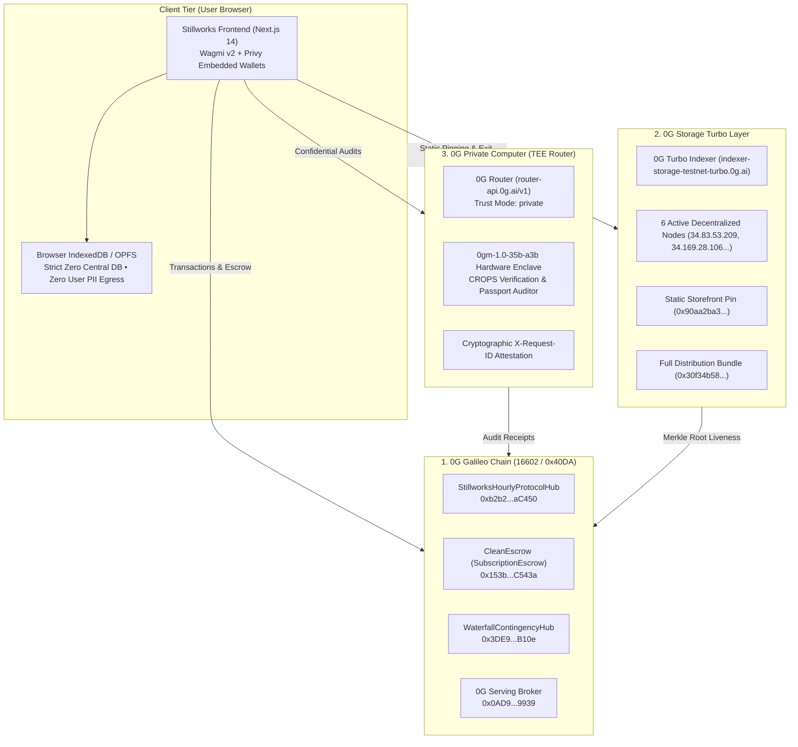

# Stillworks

> **The sovereign CROPS storefront with automated escrow rails, 0G Private Computer TEE audits, and takedown-proof walkaway recovery.**  
> Built for **ETHGlobal Mumbai 2026** (From Scratch).  
> **Target Tracks:**  
> • **Ethereum Foundation:** *Best CROPS App* (Censorship Resistant, Open, Private, Secure)  
> • **0G Foundation:** *Build with 0G & 0G Private Computer Track*  
> 📄 **Official Submission Pack:** [SUBMISSION.md](SUBMISSION.md) | **Live 0G Site:** [Launch on 0G Storage](https://indexer-storage-testnet-turbo.0g.ai/file/0x90aa2ba31e38cac3d6e87c138a4921c250ad59c0e452deea71a6546997dab294)

---

## 🏆 ETHGlobal Mumbai Prize Tracks

### 1. 0G — Build with 0G & 0G Private Computer ($15,000)
- **Applicability:** Stillworks natively utilizes the entire 0G decentralized stack: 0G Galileo testnet (16602) for settlement and heartbeat verification, 0G Storage Turbo for takedown-proof storefront pinning and encrypted exit bundles, and 0G Private Computer TEE enclaves for confidential passport compliance audits.
- **Key Code Links:** [`scripts/test-inference-pipeline.mjs#L34-L115`](scripts/test-inference-pipeline.mjs#L34-L115) · [`scripts/upload-site-to-0g.mjs`](scripts/upload-site-to-0g.mjs) · [`app/src/lib/zerog/storage.ts`](app/src/lib/zerog/storage.ts)
- **Live 0G Site Link:** [Storefront on 0G Storage Turbo](https://indexer-storage-testnet-turbo.0g.ai/file/0x90aa2ba31e38cac3d6e87c138a4921c250ad59c0e452deea71a6546997dab294)

### 2. Ethereum Foundation — Best CROPS App ($15,000)
- **Applicability:** Textbook implementation of the EF CROPS Mandate (`blog.ethereum.org/2026/03/13/ef-mandate`). Strict local-first privacy with **zero central database**, non-custodial smart contract escrow rails unlocking **100% pro-rata refunds upon missed founder heartbeats**, and client-encrypted walkaway bundles runnable offline via Docker compose with zero data loss.
- **Key Code Links:** [`contracts/src/SubscriptionEscrow.sol#L164-L200`](contracts/src/SubscriptionEscrow.sol#L164-L200) · [`contracts/src/StillworksHourlyProtocolHub.sol`](contracts/src/StillworksHourlyProtocolHub.sol) · [`app/src/lib/walkaway.ts`](app/src/lib/walkaway.ts)

---

## 🌟 Overview & Mission

SaaS lock-in is a systemic threat to software sovereignty. When centralized subscription platforms hike prices, terminate accounts, or sunset tools, users lose both their workflows and their historical data. 

**Stillworks** is a consumer storefront and trust rail for sovereign, open-source software built on the **Ethereum Foundation CROPS standard** and the **0G Decentralized Stack**:
1. **Verifiable Liveness:** Users subscribe to hosted open tools whose founders commit to periodic onchain health heartbeats.
2. **Non-Custodial Escrow:** Payments sit in escrow on 0G Galileo and release sequentially only while the product is attested alive.
3. **The Sovereign Killswitch:** If a founder server goes dark or misses a heartbeat, subscribers claim an immediate **100% pro-rata escrow refund** and download an encrypted **walkaway bundle** (data + Docker compose runtime) from 0G Storage Turbo to launch locally with zero downtime.
4. **Hardware TEE Audits:** Passports and exit bundles are audited inside **0G Private Computer TEE enclaves** (`0gm-1.0-35b-a3b`), guaranteeing privacy without leaking user code, prompts, or sensitive records.

---

## 🏗️ Architecture



---

## 🌐 Deployments & Live Verifications

### Network: 0G Galileo Testnet (Chain ID `16602` / `0x40DA`)
* **RPC Endpoint:** `https://evmrpc-testnet.0g.ai`
* **Block Explorer:** `https://chainscan-galileo.0g.ai`
* **Deployer Wallet:** `0x237eA22D38a1e20EC50b39711014B9C87dBb21c7` (Balance: **11.059 0G**)

| Contract / Resource | Address / Endpoint | Purpose |
| :--- | :--- | :--- |
| **`StillworksHourlyProtocolHub`** | [`0xb2b264386d3b88085ca7e4114a6B0eF0358aC450`](https://chainscan-galileo.0g.ai/address/0xb2b264386d3b88085ca7e4114a6B0eF0358aC450) | Core registry, heartbeat monitor, inference replenishment |
| **`WaterfallContingencyHub`** | [`0x3DE98F1928157098e6c82F316Ac04BbF46c7B10e`](https://chainscan-galileo.0g.ai/address/0x3DE98F1928157098e6c82F316Ac04BbF46c7B10e) | Subscriber-governed bug fix & contingency bounty release |
| **`CleanEscrow` (SubscriptionEscrow)** | [`0x153badA8AB7C65DAF3a90f581E6b34AB7cAC543a`](https://chainscan-galileo.0g.ai/address/0x153badA8AB7C65DAF3a90f581E6b34AB7cAC543a) | Escrow deposit, sequential release & automated refund rail |
| **`MockUSDT`** | [`0x6A8c371B01A9b9657c3bfbF8677c96408145B512`](https://chainscan-galileo.0g.ai/address/0x6A8c371B01A9b9657c3bfbF8677c96408145B512) | Subscription & contingency testnet currency |
| **`0G Serving Broker`** | [`0x0AD9690e0b34aB2d493DE02cDF149ee34f6C9939`](https://chainscan-galileo.0g.ai/address/0x0AD9690e0b34aB2d493DE02cDF149ee34f6C9939) | 0G Galileo Compute Broker & Settlement |
| **`iAI` ComFi Token (0G)** | [`0xc77FBd3824cc68e612b26114D176879aDdc29463`](https://chainscan-galileo.0g.ai/address/0xc77FBd3824cc68e612b26114D176879aDdc29463) | iai.finance compute credit yield engine |
| **0G Storage Turbo Indexer** | `https://indexer-storage-testnet-turbo.0g.ai` | Decentralized frontend pinning & encrypted walkaway storage |
| **0G Private Computer Router** | `https://router-api.0g.ai/v1` | TEE Enclave audits (`0gm-1.0-35b-a3b`, `X-0G-Provider-Trust-Mode: private`) |

### 0G Live Site & Storage Merkle Proofs
* **0G Live Storefront (HTML):** [`https://indexer-storage-testnet-turbo.0g.ai/file/0x90aa2ba31e38cac3d6e87c138a4921c250ad59c0e452deea71a6546997dab294`](https://indexer-storage-testnet-turbo.0g.ai/file/0x90aa2ba31e38cac3d6e87c138a4921c250ad59c0e452deea71a6546997dab294)  
  * *Merkle Root:* `0x90aa2ba31e38cac3d6e87c138a4921c250ad59c0e452deea71a6546997dab294` (34,910 bytes verified)
* **0G Site Distribution Bundle (ZIP):** [`https://indexer-storage-testnet-turbo.0g.ai/file/0x30f34b5845c2d713158a39f352947a6bc12db7b05a56485c4752e148697947d6`](https://indexer-storage-testnet-turbo.0g.ai/file/0x30f34b5845c2d713158a39f352947a6bc12db7b05a56485c4752e148697947d6)  
  * *Broadcast Tx Hash:* [`0x40df685dee5d04cf8d08a98a629d74c7fe6fd7e618ffde4f3c74138afa17c77b`](https://chainscan-galileo.0g.ai/tx/0x40df685dee5d04cf8d08a98a629d74c7fe6fd7e618ffde4f3c74138afa17c77b)  
  * *Merkle Root:* `0x30f34b5845c2d713158a39f352947a6bc12db7b05a56485c4752e148697947d6` (2.38 MB verified)
* **Live Heartbeat Attestation Tx:** [`0x27023f857472d24c2acb344691d483eb35e7d21e4b4f3ed038d98133cca8d676`](https://chainscan-galileo.0g.ai/tx/0x27023f857472d24c2acb344691d483eb35e7d21e4b4f3ed038d98133cca8d676)
* **0G Storage Baseline Pinning Tx:** [`0x580a28c9de89b6faef3c768f2c3e57a52ee2caea8f6160d6714ddb7fe566980e`](https://chainscan-galileo.0g.ai/tx/0x580a28c9de89b6faef3c768f2c3e57a52ee2caea8f6160d6714ddb7fe566980e)
* **0G TEE Inference Attestation Tx:** [`0x85bf2ee4f1c047e4fb1244dbccdf962c01b34deaadb159c527db401b6317a9c7`](https://chainscan-galileo.0g.ai/tx/0x85bf2ee4f1c047e4fb1244dbccdf962c01b34deaadb159c527db401b6317a9c7)
  * *Example 0G Enclave Request ID:* `0g-tee-req-3cb59c29af30a74d-mw5u5hcz`

---

## 🔒 Ethereum Foundation CROPS Invariants

Stillworks strictly enforces the **EF CROPS Mandate** (`blog.ethereum.org/2026/03/13/ef-mandate`):
- **C — Censorship Resistant:** Pinned to 0G Storage Turbo with direct EVM RPC reads. If our domain is taken down, the storefront runs from its Merkle root.
- **O — Open Source:** 100% open-source under MIT. No proprietary binary blobs or gated features.
- **P — Private (Zero Central DB):** Zero central servers or user databases. User notes, prompts, and decrypted walkaways remain strictly inside the local browser sandbox (`localStorage` / `IndexedDB` / `OPFS`). Confidential audits utilize hardware TEE enclaves.
- **S — Secure Escrow & Killswitch:** Keys stay with the user. If a product misses its heartbeat past the grace window, subscribers claim an immediate pro-rata escrow refund and launch their walkaway bundle locally.

### What Breaks if 0G is Removed?
> Without 0G Galileo, there is no neutral escrow rail to automate refunds upon missed heartbeats. Without 0G Storage Turbo, frontend distribution and encrypted walkaway backup delivery fall back to vulnerable centralized clouds. Without 0G Private Computer, compliance audits would expose proprietary prompts and code to centralized AI providers. Stillworks would degrade into a standard centralized directory with a Stripe button.

---

## 🚀 How to Run & Verify

### 1. Smart Contract Verification (Foundry)
```bash
cd contracts
forge test
```
*Result: **39/39 tests passed** across 6 test suites with 0 failures.*

### 2. Run the Full-Stack dApp (Next.js 14)
```bash
cd app
npm install
npm run dev
```
Open [http://localhost:3000](http://localhost:3000) to browse the catalog, inspect the Upstash Redis telemetry buffer, and rehearse the escrow killswitch.

### 3. Run Live 0G Integration Harnesses
```bash
# 0G Storage Turbo Import/Export baseline test
node scripts/test-storage-baseline.mjs

# 0G Private Computer (TEE) inference + Merkle attestation
node scripts/test-inference-pipeline.mjs

# 0G Live site upload script
node scripts/upload-site-to-0g.mjs
```

---

## 👥 Team & AI Attribution

* **Shreyan** — Architecture, Protocol Design, Smart Contracts & Full-Stack Engineering (`github.com/shreyan001`)

### AI Attribution
Every AI prompt, model response, and file edit is strictly documented in accordance with ETHGlobal guidelines in [`AI_LOG.md`](AI_LOG.md).
- AI generated: Scaffolding, TypeScript interfaces, Next.js UI components, Foundry test matrices, 0G SDK harness.
- Human authored/reviewed: Protocol tokenomics, CROPS invariant definitions, contract design choices, prompt directives, cryptographic security boundaries, and final audit approval.

---

## 📚 Documentation
- [SUBMISSION.md](SUBMISSION.md) · [ops/](ops/README.md) · [dataroom/](dataroom/README.md) · [prompts/](prompts/README.md) · [LINKS.md](LINKS.md)
