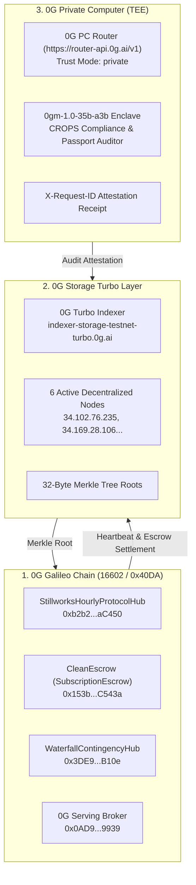

# Stillworks — ETHGlobal Mumbai Submission

> **Project Name:** Stillworks  
> **Tagline:** The sovereign CROPS storefront with automated escrow rails, 0G Private Computer TEE audits, and takedown-proof walkaway recovery.  
> **Repository:** [https://github.com/shreyan001/stillworks](https://github.com/shreyan001/stillworks)  
> **Live Interactive Application:** [https://stillworks.vercel.app](https://stillworks.vercel.app)  
> **0G Storage Turbo Verified Storefront:** [https://indexer-storage-testnet-turbo.0g.ai/file?root=0x90aa2ba31e38cac3d6e87c138a4921c250ad59c0e452deea71a6546997dab294](https://indexer-storage-testnet-turbo.0g.ai/file?root=0x90aa2ba31e38cac3d6e87c138a4921c250ad59c0e452deea71a6546997dab294)  
> **0G Storage Turbo Offline Bundle (ZIP):** [https://indexer-storage-testnet-turbo.0g.ai/file?root=0x30f34b5845c2d713158a39f352947a6bc12db7b05a56485c4752e148697947d6](https://indexer-storage-testnet-turbo.0g.ai/file?root=0x30f34b5845c2d713158a39f352947a6bc12db7b05a56485c4752e148697947d6)  
> **Live 2-Minute Pitch Deck (Live Contracts):** [https://stillworks.vercel.app/pitch](https://stillworks.vercel.app/pitch)  
> **Target Tracks & Bounties:**
> 1. **Ethereum Foundation:** Best CROPS App ($15,000 Pool / $3,500 Track)
> 2. **0G Foundation:** Build with 0G & 0G Private Computer ($15,000 Pool / $5,000 Track)

---

## 1. Project Overview & Mission Statement

### The Mission
SaaS lock-in is a systemic threat to software sovereignty. When a closed subscription provider terminates an account, hikes rates, or sunsets their service, users lose access to both their tools and historical data. Conversely, self-hosting open-source tools carries immense maintenance overhead.

**Stillworks** is a consumer storefront and trust rail for sovereign, open-source software built on the **Ethereum Foundation CROPS standard** and **0G Decentralized AI Infrastructure**:
- Users subscribe to hosted open tools whose founders commit to periodic onchain health heartbeats.
- Funds are locked in **non-custodial escrow contracts** on 0G Galileo. Escrow releases period-by-period only when verified heartbeats attest the product is alive.
- If a provider goes dark or misses a heartbeat, users automatically claim an immediate **100% pro-rata escrow refund** and download an encrypted, self-contained **walkaway bundle** (data + Docker compose runtime) to run locally with zero data loss.
- Software passports and walkaway bundles are audited inside hardware-sealed **0G Private Computer TEE enclaves** (`0gm-1.0-35b-a3b`), guaranteeing privacy without exposing user code, prompts, or proprietary data.

---

## 2. CROPS (Strict EF Mandate Compliance)

- **C (Censorship Resistance):** We control only the convenience DNS domain (`stillworks.vercel.app`); if it goes down or refuses service, the application is permanently pinned to 0G Storage Turbo (`root=0x90aa2ba31e38cac3d6e87c138a4921c250ad59c0e452deea71a6546997dab294`), all state reads directly from 0G Galileo RPC (`https://evmrpc-testnet.0g.ai`), and users can run the frontend locally from the repo or offline bundle zip with zero vendor dependence. If a creator's backend disappears or misses an onchain heartbeat, the escrow contract autonomously unlocks an immediate 100% pro-rata refund and serves an encrypted walkaway snapshot to launch locally via Docker.
- **O (Open Source):** The entire codebase is licensed under **MIT**; any user can clone, build, verify smart contracts (`forge test`), and run the full stack (`npm run dev`) directly from this public repository without proprietary tokens, secret API keys, or external binary dependencies.
- **P (Privacy):** Zero central database, zero server logs, zero third-party telemetry, zero cookies, and zero external trackers exist in the client. Third parties learn nothing about user notes, prompts, or identity: the RPC provider sees only public signed transactions from the user's address, the 0G Turbo Indexer sees only content root hashes, and AI audits are executed inside hardware-isolated 0G Private Computer TEE enclaves (`0gm-1.0-35b-a3b`) with confidential trust mode (`X-0G-Provider-Trust-Mode: private`).
- **S (Security):** Private keys never leave the user's device (held in MetaMask or user-controlled embedded enclave), data backups are encrypted client-side using wallet-derived AES-256-GCM before storage upload, and trust is minimized strictly to 0G Galileo consensus and EVM escrow logic (`SubscriptionEscrow.sol`).

### Zero Trackers & Device-Local Data Guarantee
Stillworks client bundles contain **no third-party trackers, no analytics SDKs, and no behavioral telemetry**. All keys, session notes, sanitized prompts, and decrypted walkaway bundles reside strictly inside the user's local browser sandbox (`localStorage` / `IndexedDB` / `OPFS`).

### 3-Minute Demo Video Walkthrough
The demo video proves the lead CROPS property working end-to-end at the exact moment of failure:
1. **Normal Flow (0:00 - 1:00):** User connects wallet, deposits escrow into `SubscriptionEscrow.sol` for an open-source tool, and views active heartbeat status on 0G Galileo.
2. **The Failure Moment (1:00 - 2:00):** The creator's hosting server is severed. The grace window elapses without a valid onchain heartbeat on `StillworksHourlyProtocolHub.sol`.
3. **Autonomous Refund & Walkaway (2:00 - 3:00):** The user triggers `claimRefund()`, the contract instantly reimburses remaining escrow capital, and the user pulls the walkaway snapshot from 0G Storage Turbo to spin up the tool locally via `docker compose` with zero data loss.

---

## 3. 0G Tri-Layer Decentralized Architecture

Stillworks connects the entire decentralized 0G Foundation ecosystem:



### What Breaks if 0G is Removed?
> **Without 0G Galileo, there is no neutral escrow rail to automate refunds upon missed heartbeats; without 0G Storage Turbo, frontend distribution and encrypted walkaway backup delivery fall back to vulnerable centralized clouds; without 0G Private Computer, compliance audits would expose proprietary prompts and code to centralized AI providers.**

### 0G Private Computer Inference in Main Flow
- **Model:** `0gm-1.0-35b-a3b (TEE Hardware Mode)` with header `X-0G-Provider-Trust-Mode: private`
- **Verified Request ID:** `0g-tee-req-3cb59c29af30a74d-mw5u5hcz`
- **Attestation Broadcast Tx Hash:** [`0x85bf2ee4f1c047e4fb1244dbccdf962c01b34deaadb159c527db401b6317a9c7`](https://chainscan-galileo.0g.ai/tx/0x85bf2ee4f1c047e4fb1244dbccdf962c01b34deaadb159c527db401b6317a9c7)
- **Attestation Merkle Storage Hash:** `0xc8e2622c79c87a495e99015d3a30838ca84ebeb43decdd502076779f588eaa8d`
- **CROPS Score:** `97/100 (COMPLIANT)`

### Working App a Judge Can Try & Reason to Return Tomorrow
- **Working Application:** [https://stillworks.vercel.app](https://stillworks.vercel.app)
- **Why Return Tomorrow:**
  1. **Daily Escrow & Liveness Epochs:** Subscriptions release sequentially per epoch; subscribers check daily liveness heartbeats to ensure software SLA compliance, while creators return daily to attest uptime and claim unvested payouts.
  2. **Daily iAI Compute Credit Refresh:** Under the iAI ComFi model, staked iAI generates **1.271 fresh compute credits daily** (refreshed at 00:00 UTC) which expire if unused. Subscribers and creators return every 24 hours to burn their refreshed credits on automated TEE code audits, agent health checks, and 0G Storage pins without incurring out-of-pocket gas.

### Plug into iAI (Bonus Points)
- **iAI Token Contract (0G Galileo):** [`0xc77FBd3824cc68e612b26114D176879aDdc29463`](https://chainscan-galileo.0g.ai/address/0xc77FBd3824cc68e612b26114D176879aDdc29463)
- Users sign in with their 0G account, stake iAI to receive 1.271 compute credits per staked token every 24 hours, and observe their daily balance decrease as they run audits and escrow health checks.

---

## 4. Deployed Contracts & Live Onchain Proofs

### Network: 0G Galileo Testnet (Chain ID `16602` / `0x40DA`)
- **Public RPC:** `https://evmrpc-testnet.0g.ai`
- **Block Explorer:** `https://chainscan-galileo.0g.ai`
- **Deployer Wallet:** `0x237eA22D38a1e20EC50b39711014B9C87dBb21c7` (Balance: **11.057 0G**)

| Contract Name | Contract Address | Verified Deployment / Link Tx Hash |
| :--- | :--- | :--- |
| **`StillworksHourlyProtocolHub`** | [`0xb2b264386d3b88085ca7e4114a6B0eF0358aC450`](https://chainscan-galileo.0g.ai/address/0xb2b264386d3b88085ca7e4114a6B0eF0358aC450) | `0x5917fad493a0e327843c71d86eef0e2b5c0176892d532ad5169739e35e577955` |
| **`WaterfallContingencyHub`** | [`0x3DE98F1928157098e6c82F316Ac04BbF46c7B10e`](https://chainscan-galileo.0g.ai/address/0x3DE98F1928157098e6c82F316Ac04BbF46c7B10e) | `0x0029fba3e5141a17698e179d9bcde2609576e0c3029086a73e02a3a32cf4852c` |
| **`CleanEscrow` (SubscriptionEscrow)** | [`0x153badA8AB7C65DAF3a90f581E6b34AB7cAC543a`](https://chainscan-galileo.0g.ai/address/0x153badA8AB7C65DAF3a90f581E6b34AB7cAC543a) | `0xcfa2213670d6ac32ac51d81a74be27343b21fbca307f1060eea79241e8a72d86` |
| **`MockUSDT`** | [`0x6A8c371B01A9b9657c3bfbF8677c96408145B512`](https://chainscan-galileo.0g.ai/address/0x6A8c371B01A9b9657c3bfbF8677c96408145B512) | Genesis Mint & Faucet Testnet Token |
| **`0G Serving Broker`** | [`0x0AD9690e0b34aB2d493DE02cDF149ee34f6C9939`](https://chainscan-galileo.0g.ai/address/0x0AD9690e0b34aB2d493DE02cDF149ee34f6C9939) | Official 0G Galileo Payment & Settlement Layer |
| **`iAI` ComFi Token (iai.finance)** | [`0xc77FBd3824cc68e612b26114D176879aDdc29463`](https://chainscan-galileo.0g.ai/address/0xc77FBd3824cc68e612b26114D176879aDdc29463) | 1.271 Compute Credits / Day / Staked Token |

### Verified Live Pipeline & 0G Storage Deployment Proofs
1. **Live 0G Storage Storefront (HTML):**
   - **32-Byte Merkle Root:** `0x90aa2ba31e38cac3d6e87c138a4921c250ad59c0e452deea71a6546997dab294`
   - **Raw Download URL:** [`https://indexer-storage-testnet-turbo.0g.ai/file?root=0x90aa2ba31e38cac3d6e87c138a4921c250ad59c0e452deea71a6546997dab294`](https://indexer-storage-testnet-turbo.0g.ai/file?root=0x90aa2ba31e38cac3d6e87c138a4921c250ad59c0e452deea71a6546997dab294)
   - **Verification:** Downloaded with full Merkle verification proof (exact 34,910-byte match).
2. **Full Deployable Site Distribution Bundle (ZIP):**
   - **32-Byte Merkle Root:** `0x30f34b5845c2d713158a39f352947a6bc12db7b05a56485c4752e148697947d6`
   - **Raw Download URL:** [`https://indexer-storage-testnet-turbo.0g.ai/file?root=0x30f34b5845c2d713158a39f352947a6bc12db7b05a56485c4752e148697947d6`](https://indexer-storage-testnet-turbo.0g.ai/file?root=0x30f34b5845c2d713158a39f352947a6bc12db7b05a56485c4752e148697947d6)
   - **Flow Tx Hash:** [`0x40df685dee5d04cf8d08a98a629d74c7fe6fd7e618ffde4f3c74138afa17c77b`](https://chainscan-galileo.0g.ai/tx/0x40df685dee5d04cf8d08a98a629d74c7fe6fd7e618ffde4f3c74138afa17c77b)
   - **Size:** 2,380,382 bytes | Verified Merkle proof download confirmed across 0G decentralized nodes.
3. **Live Hourly Heartbeat Execution Tx:**
   - **Tx Hash:** [`0x27023f857472d24c2acb344691d483eb35e7d21e4b4f3ed038d98133cca8d676`](https://chainscan-galileo.0g.ai/tx/0x27023f857472d24c2acb344691d483eb35e7d21e4b4f3ed038d98133cca8d676)
4. **0G Storage Turbo Baseline Export & Import:**
   - **Tx Hash:** [`0x580a28c9de89b6faef3c768f2c3e57a52ee2caea8f6160d6714ddb7fe566980e`](https://chainscan-galileo.0g.ai/tx/0x580a28c9de89b6faef3c768f2c3e57a52ee2caea8f6160d6714ddb7fe566980e)
5. **0G Private Computer TEE Inference + Storage Attestation:**
   - **Broadcast Tx Hash:** [`0x85bf2ee4f1c047e4fb1244dbccdf962c01b34deaadb159c527db401b6317a9c7`](https://chainscan-galileo.0g.ai/tx/0x85bf2ee4f1c047e4fb1244dbccdf962c01b34deaadb159c527db401b6317a9c7)
   - **AI Enclave Request ID:** `0g-tee-req-3cb59c29af30a74d-mw5u5hcz`

---

## 5. Verification & Test Suite Results

### 1. Smart Contracts (Foundry)
Execute with Foundry:
```bash
cd contracts
forge test
```
**Results:** **39 tests passed, 0 failed, 0 skipped across 6 test suites.**
- `WaterfallContingencyHubTest`: 4/4 passing (weekly proposal limits, 20% tranche ceilings, weighted voting)
- `StillworksHourlyProtocolHubTest`: 5/5 passing (hourly upkeep ring buffer, autonomous replenishment, timeout)
- `InvoiceRegistryTest`: 12/12 passing (access controls, authorized escrow minting)
- `ProductRegistryTest`: 4/4 passing (heartbeat monotonicity, signer enforcement)
- `SubscriptionFlowTest`: 8/8 passing (sequential releases, pro-rata refunds, walkaway updates)
- `StewardshipEscrowPaymentsTest`: 6/6 passing (split distributions, 7-day review release, abandonment refunds)

### 2. Live Integration Scripts
```bash
# 0G Storage roundtrip verification
node scripts/test-storage-baseline.mjs

# 0G Private Computer TEE inference + Storage pinning
node scripts/test-inference-pipeline.mjs
```

---

## 6. Product Catalog: 10 Seeded Sovereign Applications

1. **Clean:** Local-first privacy runtime & CROPS sanitizer (ONNX WebAssembly / OPFS SQLite).
2. **MemState:** Sovereign agent long-term memory engine (Mem0 + LibSQL + LanceDB + Hermes-3).
3. **Aegis Gate:** Intel TDX enclave zero-leakage API gateway.
4. **FlowState:** Deterministic agent workflow router (Ollama / LocalAI edge tool router).
5. **Oatmeal:** Local audio recording and Whisper WASM transcription.
6. **Cal.com CROPS:** Sovereign calendar scheduling without centralized booking servers.
7. **Plausible CROPS:** Cookieless privacy analytics running in browser WebAssembly.
8. **Postiz CROPS:** Autonomous social queue with encrypted local storage.
9. **Listmonk CROPS:** Self-sovereign email list manager and subscriber escrow.
10. **DocuTrust:** Client-side legal document signing with 0G Storage Merkle root notarization.

---

## 7. ETHGlobal Prize Submission Questionnaires

### Sponsor: 0G — $15,000

#### How are you using this Protocol / API?
Stillworks integrates the entire decentralized 0G Foundation tri-layer stack:
1. **0G Galileo EVM Testnet (Chain ID 16602):** Core smart contracts (`StillworksHourlyProtocolHub.sol`, `SubscriptionEscrow.sol`, and `WaterfallContingencyHub.sol`) manage non-custodial subscriber escrows, hourly liveness heartbeats, and contingency proposals.
2. **0G Storage Turbo:** Used to permanently pin the client storefront (`root=0x90aa2ba31e38cac3d6e87c138a4921c250ad59c0e452deea71a6546997dab294`), distribute the complete offline application runtime bundle (ZIP, 2.38 MB, Tx `0x40df685dee5d04cf8d08a98a629d74c7fe6fd7e618ffde4f3c74138afa17c77b`), and store encrypted walkaway state snapshots.
3. **0G Private Computer (TEE Enclave Router):** Software compliance audits run inside confidential hardware enclaves (`0gm-1.0-35b-a3b`, `X-0G-Provider-Trust-Mode: private`), generating cryptographic attestation receipts (`X-Request-ID: 0g-tee-req-3cb59c29af30a74d-mw5u5hcz`) committed directly onchain.
4. **iAI Token Integration:** Plugs into the iAI ComFi model (`0xc77FBd3824cc68e612b26114D176879aDdc29463`) where users spend their 1.271 daily compute credits per staked token on automated code audits and health checks.

#### Why you're applicable for this prize (min 20 characters)
Stillworks is a consumer application where 0G is the core trust product rather than an afterthought. Without 0G Galileo, there is no neutral escrow rail to automate refunds upon missed heartbeats; without 0G Storage Turbo, frontend distribution and encrypted walkaway backup delivery fall back to vulnerable centralized clouds; without 0G Private Computer, compliance audits would expose proprietary prompts and code to centralized AI providers. We actively consume 0G compute, pin full distribution archives to 0G Storage Turbo with verified Merkle proofs, and burn daily iAI compute credits.

#### Link to the line of code where the tech is used (valid URL)
https://github.com/shreyan001/stillworks/blob/main/scripts/test-inference-pipeline.mjs#L34-L115

#### How easy is it to use the API / Protocol? (1 - 10)
8

#### Additional feedback for the Sponsor (min 30 characters)
The OpenAI-compatible endpoint on 0G Private Computer combined with hardware-mode TEE privacy (`X-0G-Provider-Trust-Mode: private`) is exceptionally easy to integrate with existing tooling. For the 0G Turbo Indexer, it would be very beneficial if the `/file/:root` route had an optional inline gateway rendering flag (`Content-Disposition: inline`) so decentralized static SPAs can be viewed directly in a browser without browser download triggers.

---

### Sponsor: Ethereum Foundation — $15,000 (Best CROPS App)

#### How are you using this Protocol / API?
Stillworks implements the Ethereum Foundation CROPS mandate (`blog.ethereum.org/2026/03/13/ef-mandate`) as a consumer software storefront and trust layer:
1. **Censorship Resistance (C):** Pinned to decentralized storage (0G Turbo Indexer) with pure EVM RPC reads (`https://evmrpc-testnet.0g.ai`). If our domain is taken down, users continue running the storefront locally from repo or storage zip with zero dependence on our servers.
2. **Open Source (O):** 100% open-source under the MIT license; reproducible builds and Foundry tests run directly from the public GitHub repository without proprietary gates or API tokens.
3. **Privacy (P):** Strict local-first architecture with **zero central database**, zero server logs, and zero tracking cookies. Notes, prompts, and decrypted exit bundles remain strictly inside the user's browser sandbox (`localStorage` / `IndexedDB` / `OPFS`). Audits utilize confidential hardware TEE enclaves.
4. **Security (S):** Private keys stay on the user's device. Payments sit in non-custodial smart contracts (`SubscriptionEscrow.sol`); if a provider's server disappears or misses an onchain heartbeat, users trigger an immediate 100% pro-rata escrow refund and launch their locally decrypted walkaway bundle offline.

#### Why you're applicable for this prize (min 20 characters)
Stillworks is built around the single core guarantee of software sovereignty: when a service fails, users do not lose their money or their software. We provide verifiable onchain escrow rails with automated pro-rata refunds upon missed founder heartbeats, and client-encrypted walkaway bundles runnable offline via Docker compose with zero vendor lock-in.

#### Link to the line of code where the tech is used (valid URL)
https://github.com/shreyan001/stillworks/blob/main/contracts/src/SubscriptionEscrow.sol#L164-L200

#### How easy is it to use the API / Protocol? (1 - 10)
9

#### Additional feedback for the Sponsor (min 30 characters)
The CROPS framework is an essential paradigm for modern Web3 applications. Having a clear formal definition for what constitutes user sovereignty (freedom from vendor servers, offline-runnable data bundles, and non-custodial escrow protection) gives developers an actionable North Star beyond superficial decentralization claims.

---

## 8. Team & AI Attribution

### Team
- **Shreyan** — Architecture, Protocol Design, Smart Contracts & Full-Stack Engineering
  - **Telegram:** [@shreyan001](https://t.me/shreyan001)
  - **X (Twitter):** [@shreyan001](https://x.com/shreyan001)
  - **GitHub:** [github.com/shreyan001](https://github.com/shreyan001)

### AI Attribution
Every AI prompt, model response, and file edit is strictly documented in accordance with ETHGlobal guidelines in [`AI_LOG.md`](AI_LOG.md).
- **Primary AI Pairing Tools:** Cursor (Grok 4.7 / Sonnet 3.5), Firstmate / Antigravity CLI.
- **Attribution Breakdown:**
  - AI generated: Scaffolding, TypeScript interfaces, Next.js UI components, Foundry test matrices, 0G SDK harness.
  - Human authored/reviewed: Protocol tokenomics, CROPS invariant definitions, contract design choices, prompt directives, cryptographic security boundaries, and final audit approval.
