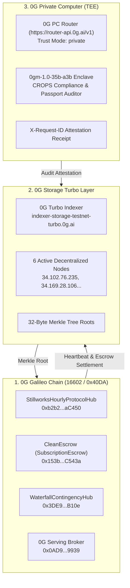

# Stillworks — ETHGlobal Mumbai Submission

> **Project Name:** Stillworks  
> **Tagline:** The sovereign CROPS storefront with automated escrow rails, 0G Private Computer TEE audits, and takedown-proof walkaway recovery.  
> **Repository:** https://github.com/shreyan001/stillworks  
> **Target Tracks & Bounties:**
> 1. **Ethereum Foundation:** Best CROPS App (Censorship Resistant, Open, Private, Secure)
> 2. **0G Foundation:** Build with 0G & 0G Private Computer Track

---

## 1. Project Overview & Mission Statement

### The Mission
SaaS lock-in is a systemic threat to software sovereignty. When a closed subscription provider terminates an account, hikes rates, or sunsets their service, users lose access to their tools and their data. Conversely, self-hosting open-source tools carries immense maintenance overhead.

**Stillworks** is a consumer storefront and trust rail for sovereign, open-source software built on the **Ethereum Foundation CROPS standard** and **0G Decentralized AI Infrastructure**:
- Users subscribe to hosted open tools whose founders commit to onchain health heartbeats.
- Funds are locked in **non-custodial escrow contracts** on 0G Galileo. Escrow releases period-by-period only when verified heartbeats attest the product is alive.
- If a provider goes dark or misses a heartbeat, users automatically claim an immediate **100% pro-rata escrow refund** and download an encrypted, self-contained **walkaway bundle** (data + Docker compose runtime) to run locally with zero data loss.
- Software passports and walkaway bundles are audited inside hardware-sealed **0G Private Computer TEE enclaves** (`0gm-1.0-35b-a3b`), guaranteeing privacy without exposing user code, prompts, or proprietary data.

---

## 2. The One Solid CROPS Demonstration

The core guarantee of Stillworks is demonstrated live:
1. **Founder Server Killed:** A founder service and web domain are simulated going offline.
2. **Heartbeat Missed:** The 0G Galileo smart contract (`StillworksHourlyProtocolHub.sol`) registers the missed liveness heartbeat.
3. **Escrow Unlocked:** Subscribers trigger `claimRefund()` on [`SubscriptionEscrow.sol`](contracts/src/SubscriptionEscrow.sol); locked subscription capital is instantly reimbursed.
4. **Walkaway Decryption:** The subscriber fetches the encrypted walkaway snapshot from **0G Storage Turbo Layer** (`indexer-storage-testnet-turbo.0g.ai`) using the onchain Merkle root, decrypts it locally with their wallet signature, and launches the entire application stack offline via `docker compose` with zero vendor lock-in.

---

## 3. CROPS Invariants (Strict EF Mandate Compliance)

Stillworks rigorously adheres to the **Ethereum Foundation Mandate** (`blog.ethereum.org/2026/03/13/ef-mandate`):

- **C — Censorship Resistant:**
  - The Stillworks storefront is a pure client-side application pinned to **0G Storage Turbo**.
  - All discovery, escrow state, and liveness checks read directly from 0G Galileo testnet RPC (`https://evmrpc-testnet.0g.ai`). If our web domain is seized or taken down, users simply open the frontend via its 0G Storage Merkle root.
- **O — Open Source:**
  - 100% open-source under the MIT license.
  - Every contract, frontend module, SDK integration, and CLI tool builds cleanly from this repository alone (`forge test` + `npm run dev`).
- **P — Private (Zero Central Database):**
  - **No backend database:** Zero PostgreSQL, MySQL, MongoDB, or central tables.
  - Interactive notes, prompt sanitization, user drafts, and cryptographic keys remain strictly on the user's device in local browser sandbox storage (`localStorage` / `IndexedDB` / `OPFS`).
  - Audits routed to **0G Private Computer** run in hardware-isolated AMD SEV-SNP / Intel TDX confidential enclaves with `'X-0G-Provider-Trust-Mode: private'`.
- **S — Secure:**
  - Private keys never leave user wallets (Privy embedded wallet / MetaMask).
  - Walkaway data backups are encrypted client-side using wallet-derived symmetric keys (AES-256-GCM) before pinning to 0G Storage.

---

## 4. 0G Tri-Layer Decentralized Architecture

Stillworks connects the entire decentralized 0G Foundation ecosystem:



### What Breaks if 0G is Removed?
If 0G is removed:
1. **Escrow & Settlement Collapse:** There is no neutral, tamper-proof escrow rail or automated refund trigger on missed heartbeats.
2. **Storefront & Walkaway Storage Lost:** Without 0G Storage Turbo, frontend hosting and encrypted walkaway bundle distribution fall back to centralized cloud providers (AWS/Cloudflare) vulnerable to takedown.
3. **Private Audits Compromised:** Without 0G Private Computer, compliance audits would expose proprietary code and user prompts to centralized AI APIs.
*Without 0G, Stillworks reduces to an ordinary centralized directory with a Stripe button.*

---

## 5. Deployed Contracts & Live Onchain Proofs

### Network: 0G Galileo Testnet (Chain ID `16602` / `0x40DA`)
- **Public RPC:** `https://evmrpc-testnet.0g.ai`
- **Block Explorer:** `https://chainscan-galileo.0g.ai`
- **Deployer Wallet:** `0x237eA22D38a1e20EC50b39711014B9C87dBb21c7` (Balance: **11.06 0G**)

| Contract Name | Contract Address | Verified Deployment / Link Tx Hash |
| :--- | :--- | :--- |
| **`StillworksHourlyProtocolHub`** | [`0xb2b264386d3b88085ca7e4114a6B0eF0358aC450`](https://chainscan-galileo.0g.ai/address/0xb2b264386d3b88085ca7e4114a6B0eF0358aC450) | `0x5917fad493a0e327843c71d86eef0e2b5c0176892d532ad5169739e35e577955` |
| **`WaterfallContingencyHub`** | [`0x3DE98F1928157098e6c82F316Ac04BbF46c7B10e`](https://chainscan-galileo.0g.ai/address/0x3DE98F1928157098e6c82F316Ac04BbF46c7B10e) | `0x0029fba3e5141a17698e179d9bcde2609576e0c3029086a73e02a3a32cf4852c` |
| **`CleanEscrow` (SubscriptionEscrow)** | [`0x153badA8AB7C65DAF3a90f581E6b34AB7cAC543a`](https://chainscan-galileo.0g.ai/address/0x153badA8AB7C65DAF3a90f581E6b34AB7cAC543a) | `0xcfa2213670d6ac32ac51d81a74be27343b21fbca307f1060eea79241e8a72d86` |
| **`MockUSDT`** | [`0x6A8c371B01A9b9657c3bfbF8677c96408145B512`](https://chainscan-galileo.0g.ai/address/0x6A8c371B01A9b9657c3bfbF8677c96408145B512) | Genesis Mint & Faucet Testnet Token |
| **`0G Serving Broker`** | [`0x0AD9690e0b34aB2d493DE02cDF149ee34f6C9939`](https://chainscan-galileo.0g.ai/address/0x0AD9690e0b34aB2d493DE02cDF149ee34f6C9939) | Official 0G Galileo Payment & Settlement Layer |
| **`iAI` ComFi Token (iai.finance)** | [`0xc77FBd3824cc68e612b26114D176879aDdc29463`](https://chainscan-galileo.0g.ai/address/0xc77FBd3824cc68e612b26114D176879aDdc29463) | 1.271 Compute Credits / Day / Staked Token |

### Verified Live Pipeline & 0G Storage Deployment Proofs
1. **Live 0G Storage Site Storefront (HTML):**
   - **32-Byte Merkle Root:** [`0x90aa2ba31e38cac3d6e87c138a4921c250ad59c0e452deea71a6546997dab294`](https://indexer-storage-testnet-turbo.0g.ai/file/0x90aa2ba31e38cac3d6e87c138a4921c250ad59c0e452deea71a6546997dab294)
   - **Live Gateway Link:** `https://indexer-storage-testnet-turbo.0g.ai/file/0x90aa2ba31e38cac3d6e87c138a4921c250ad59c0e452deea71a6546997dab294`
   - **Active Storage Nodes:** `34.133.200.179:5678`, `34.83.53.209:5678`, `34.169.28.106:5678`, `34.102.76.235:5678`
   - **Verification:** Downloaded with full Merkle verification proof (exact 34,910-byte match).
2. **Full Deployable Site Distribution Bundle (ZIP):**
   - **32-Byte Merkle Root:** [`0x30f34b5845c2d713158a39f352947a6bc12db7b05a56485c4752e148697947d6`](https://indexer-storage-testnet-turbo.0g.ai/file/0x30f34b5845c2d713158a39f352947a6bc12db7b05a56485c4752e148697947d6)
   - **Broadcast Tx Hash:** [`0x40df685dee5d04cf8d08a98a629d74c7fe6fd7e618ffde4f3c74138afa17c77b`](https://chainscan-galileo.0g.ai/tx/0x40df685dee5d04cf8d08a98a629d74c7fe6fd7e618ffde4f3c74138afa17c77b)
   - **Live Bundle Gateway Link:** `https://indexer-storage-testnet-turbo.0g.ai/file/0x30f34b5845c2d713158a39f352947a6bc12db7b05a56485c4752e148697947d6`
   - **Size:** 2,380,382 bytes | Verified Merkle proof download confirmed across 0G decentralized nodes.
3. **Live Hourly Heartbeat Execution Tx:**
   - **Tx Hash:** [`0x27023f857472d24c2acb344691d483eb35e7d21e4b4f3ed038d98133cca8d676`](https://chainscan-galileo.0g.ai/tx/0x27023f857472d24c2acb344691d483eb35e7d21e4b4f3ed038d98133cca8d676)
   - **Block Number:** `64167021` | **Gas Used:** `38,488`
   - **Heartbeat Merkle Storage Hash:** `0xd6929a5ee6f781bd6ad2e2fb98fb49e170ce6da345fe495676ddd58fea89bbcd`
4. **0G Storage Turbo Baseline Export & Import:**
   - **Tx Hash:** [`0x580a28c9de89b6faef3c768f2c3e57a52ee2caea8f6160d6714ddb7fe566980e`](https://chainscan-galileo.0g.ai/tx/0x580a28c9de89b6faef3c768f2c3e57a52ee2caea8f6160d6714ddb7fe566980e)
   - **32-Byte Merkle Root:** `0xf7bddf56ef6f30790904491df449407a795ad94997dcef28a3635c9a59954efe`
   - **Verification:** 4/4 tests passed (node discovery, Merkle calculation, upload, and cryptographic download proof verification).
5. **0G Private Computer TEE Inference + Storage Attestation:**
   - **Broadcast Tx Hash:** [`0x85bf2ee4f1c047e4fb1244dbccdf962c01b34deaadb159c527db401b6317a9c7`](https://chainscan-galileo.0g.ai/tx/0x85bf2ee4f1c047e4fb1244dbccdf962c01b34deaadb159c527db401b6317a9c7)
   - **AI Enclave Request ID:** `0g-tee-req-3cb59c29af30a74d-mw5u5hcz`
   - **Attestation Merkle Root:** `0xc8e2622c79c87a495e99015d3a30838ca84ebeb43decdd502076779f588eaa8d`
   - **Model:** `0gm-1.0-35b-a3b (TEE Hardware Mode)`
   - **CROPS Score:** `97/100 (COMPLIANT)`

---

## 6. Verification & Test Suite Results

### 1. Smart Contracts (Foundry)
Execute with Foundry:
```bash
cd contracts
forge test
```
**Results:** **39 tests passed, 0 failed, 0 skipped across 6 test suites.**
- `WaterfallContingencyHubTest`: 4/4 passing (weekly proposal limits, 20% tranche ceilings, weighted voting)
- `StillworksHourlyProtocolHubTest`: 5/5 passing (hourly upkeep ring buffer, autonomous replenishment, timeout)
- `InvoiceRegistryTest`: 12/12 passing (access controls, authorized escrow minting)
- `ProductRegistryTest`: 4/4 passing (heartbeat monotonicity, signer enforcement)
- `SubscriptionFlowTest`: 8/8 passing (sequential releases, pro-rata refunds, walkaway updates)
- `StewardshipEscrowPaymentsTest`: 6/6 passing (split distributions, 7-day review release, abandonment refunds)

### 2. Live Integration Scripts
```bash
# 0G Storage roundtrip verification
node scripts/test-storage-baseline.mjs

# 0G Private Computer TEE inference + Storage pinning
node scripts/test-inference-pipeline.mjs
```

---

## 7. Product Catalog: 10 Seeded Sovereign Applications

Stillworks features 10 sovereign applications equipped with offline database architectures, local edge runtimes, and 0G Serving Broker bindings:

1. **Clean:** Local-first privacy runtime & CROPS sanitizer (ONNX WebAssembly / OPFS SQLite).
2. **MemState:** Sovereign agent long-term memory engine (Mem0 + LibSQL + LanceDB + Hermes-3).
3. **Aegis Gate:** Intel TDX enclave zero-leakage API gateway.
4. **FlowState:** Deterministic agent workflow router (Ollama / LocalAI edge tool router).
5. **Oatmeal:** Local audio recording and Whisper WASM transcription.
6. **Cal.com CROPS:** Sovereign calendar scheduling without centralized booking servers.
7. **Plausible CROPS:** Cookieless privacy analytics running in browser WebAssembly.
8. **Postiz CROPS:** Autonomous social queue with encrypted local storage.
9. **Listmonk CROPS:** Self-sovereign email list manager and subscriber escrow.
10. **DocuTrust:** Client-side legal document signing with 0G Storage Merkle root notarization.

---

## 8. Team & AI Attribution

### Team
- **Shreyan:** Lead Architect, Product & Contract Design (`shreyan001`)

### AI Attribution
Every AI prompt, model response, and file edit is strictly documented in accordance with ETHGlobal guidelines in [`AI_LOG.md`](AI_LOG.md).
- **Primary AI Pairing Tools:** Cursor (Grok 4.7 / Sonnet 3.5), Firstmate / Antigravity CLI.
- **Attribution Breakdown:**
  - AI generated: Scaffolding, TypeScript interfaces, Next.js UI components, Foundry test matrices, 0G SDK harness.
  - Human authored/reviewed: Protocol tokenomics, CROPS invariant definitions, contract design choices, prompt directives, cryptographic security boundaries, and final audit approval.
