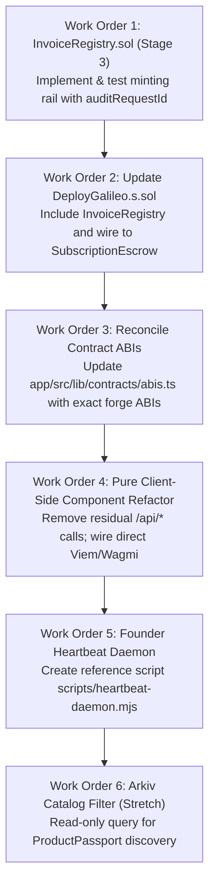

# HANDOFF & ARCHITECTURAL STRATEGY BRIEF

**Author:** Crewmate-Scout (Architectural Auditor & Researcher)  
**Recipient:** Cursor Lead Agent & First Mate  
**Target:** Stillworks Protocol — ETHGlobal Sovereign Software Storefront  
**Date:** Friday, Nov 6, 2026, ~03:45 AM IST  
**Status:** Authoritative Architectural Handover  

---

## 1. Executive Summary & Codebase Reconnaissance

A comprehensive line-by-line audit across all repositories and subdirectories (`contracts/`, `ops/`, `coordination-v2/`, `arkiv/`, `dataroom/`, and `app/`) was completed.

```mermaid
flowchart TD
    subgraph Client["Client-Side (Static Export on 0G Storage)"]
        UI["Stillworks Static dApp (Next.js 14)"]
        WAGMI["Wagmi v2 / Viem Client"]
        SDK["@0gfoundation/0g-storage-ts-sdk<br/>(MemData & Indexer)"]
    end

    subgraph ZeroG_Galileo["0G Galileo Chain (16602)"]
        PR["ProductRegistry.sol"]
        SA["SubscriptionAgreement.sol"]
        SE["SubscriptionEscrow.sol"]
        IR["InvoiceRegistry.sol (Stage 3)"]
    end

    subgraph ZeroG_Storage["0G Storage Turbo Layer"]
        IDX["https://indexer-storage-testnet-turbo.0g.ai"]
        PASSPORT["Product Passports (JSON)"]
        BUNDLE["Encrypted Walkaway Bundles"]
        FRONTEND["Static Frontend Bundle Root"]
    end

    subgraph ZeroG_PC["0G Private Computer (TEE)"]
        ROUTER["router-api-testnet.integratenetwork.work/v1"]
        TEE["Audit Engine (0gm-1.0)"]
    end

    subgraph Founder_Ops["Founder Daemon (External)"]
        CRON["Heartbeat Attestation Bot"]
    end

    UI -->|Transactions / Escrow / Refunds| ZeroG_Galileo
    UI -->|Direct HTTP GET /blob / Merkle Compute| IDX
    UI -->|Private Audit & X-Request-ID| ROUTER
    CRON -->|heartbeat(productId, period, hash)| PR
```

### Component Status Audit Table

| Module | Files Inspected | Current State | Verification / Audit Finding |
| :--- | :--- | :--- | :--- |
| **`contracts/`** | `ProductRegistry.sol`<br/>`SubscriptionAgreement.sol`<br/>`SubscriptionEscrow.sol`<br/>`DeployGalileo.s.sol` | **Stage 2 Complete (10/10 tests pass)** | • 4 tests in `ProductRegistry.t.sol` passing.<br/>• 6 tests in `SubscriptionFlow.t.sol` passing.<br/>• Cancun EVM version enabled in `foundry.toml` with Solc 0.8.19.<br/>• `DeployGalileo.s.sol` configured for Galileo (16602) reading `PRIVATE_KEY`.<br/>• **Missing:** `InvoiceRegistry.sol` (Stage 3). |
| **`ops/`** | `RULES.md`<br/>`STATE.md`<br/>`TASKS.md`<br/>`RESOURCES.md`<br/>`CONFLICTS.md`<br/>`SYSTEM.md` | **Active & Authoritative** | • Deployer wallet `0x237eA22D38a1e20EC50b39711014B9C87dBb21c7` verified with `0.1 0G` on Galileo.<br/>• Rules strictly enforce: CROPS Section, 0G Private Computer in main flow with request ID, and no trackers.<br/>• Lane C holds 0G faucet, 0G PC API key, and Arkiv faucet tasks. |
| **`coordination-v2/`** | `STATUS.md`<br/>`COMMANDS.md`<br/>`ZEROG_INFRASTRUCTURE.md`<br/>`ZEROG_DEPLOYMENT_REQUIREMENTS.md`<br/>`agents/*.md` | **Synchronized** | • Command holds on live deploy and Storage broadcasting remain active.<br/>• Multi-agent charter clearly defines Cursor as central coordination point. |
| **`app/`** | `src/app/page.tsx`<br/>`src/lib/zerog/storage.ts`<br/>`src/lib/zerog/compute.ts`<br/>`src/components/*`<br/>`next.config.mjs` | **Static Export Ready with 2 Discrepancies** | • `output: 'export'` verified.<br/>• `page.tsx` implements client-side `MemData.merkleTree()` and `Indexer.downloadToBlob()`.<br/>• ⚠️ **Discrepancy 1:** `app/src/lib/contracts/abis.ts` does NOT match `contracts/src/*.sol`.<br/>• ⚠️ **Discrepancy 2:** `StorageExplorer.tsx` and `ComputeAuditor.tsx` retain `/api/*` fetch calls that cannot execute in static export. |
| **`arkiv/`** | `schema.md`<br/>`friction.md`<br/>`reach.md`<br/>`why-arkiv.md`<br/>`how-you-use-arkiv.md` | **Scaffolded (P1 Stretch)** | • 5 markdown templates prepared with TODOs.<br/>• Schema entities mapped: `ProductPassport`, `Heartbeat`, `Listing`, `AuditReport`.<br/>• Rabdi testnet RPC tested live (`eth_chainId` = `0x76edaf` / 7794095). |
| **`dataroom/`** | `data-room-canvas.md`<br/>`README.md` | **Exhaustive Scope Baseline** | • 25 sections detailing CROPS philosophy, P0/P1 scope, competitor positioning, and the "Moment" demo video script. |

---

## 2. Architectural & Backend Necessity Analysis

### The Constraint: 0G Storage is Strictly Static
0G Storage is a decentralized content-addressed file storage network. When hosting frontends on 0G Storage, the application bundle is uploaded as static files (`index.html`, client JS, WASM, CSS) generated via `next build` with `output: 'export'`.
**Decentralized storage nodes cannot execute a Node.js server, Python runtime, or Next.js Server Components / API Routes (`/api/...`).**

### Do We Actually Need a Backend?

The short answer is: **No for the user and the storefront, but Yes for the external founder software.**

```
+---------------------------------------------------------------------------------+
|                                 STILLWORKS ARCHITECTURE                         |
+---------------------------------------------------------------------------------+
|  A. USER STOREFRONT (Client Browser)       |  B. FOUNDER SERVICE (Autonomous)   |
|  • 100% Client-Side Static dApp            |  • External Node/Go Daemon / Cron  |
|  • Hosted on 0G Storage Merkle Root        |  • Runs on Founder's Own Server    |
|  • Direct Viem/Wagmi to 0G Galileo RPC     |  • Pings local software /healthz   |
|  • Direct REST/Blob to 0G Turbo Indexer    |  • Signs & posts ProductRegistry   |
|  • Zero Centralized Database or Cookies    |    heartbeat(id, period, proof)    |
|  • Zero Server-Side Logging (Pure CROPS)   |  • Terminating this daemon is the  |
|                                            |    "Kill-Switch" demo event!       |
+---------------------------------------------------------------------------------+
```

### Detailed Flow-by-Flow Breakdown

#### A. User Flows (Subscribing, Claiming Refunds, Downloading, Auditing)
All core user flows can and **must** be 100% client-side in the browser:

1. **Reading Chain State (Catalog & Listings):**
   - **Mechanism:** Direct browser RPC call using Wagmi / Viem to `https://evmrpc-testnet.0g.ai`.
   - **Backend Needed:** ❌ No. Direct JSON-RPC over HTTPS.
2. **Reading Product Passports & Walkaway Bundles:**
   - **Mechanism:** Direct CORS-friendly HTTP GET to `https://indexer-storage-testnet-turbo.0g.ai/file/{rootHash}` or using `Indexer.downloadToBlob(rootHash)` from `@0gfoundation/0g-storage-ts-sdk`.
   - **Backend Needed:** ❌ No. 0G Storage Turbo Indexer supports public browser-originated GET requests.
3. **Subscribing & Escrow Funding:**
   - **Mechanism:** User clicks "Fund Escrow". Browser wallet (MetaMask / Injected / Privy) signs and broadcasts `SubscriptionAgreement.create(...)` followed by `SubscriptionEscrow.fund{value: deposit}(agreementId, periods)`.
   - **Backend Needed:** ❌ No. Signed directly by the user's private key.
4. **Claiming Pro-Rata Refunds:**
   - **Mechanism:** If `ProductRegistry.lastHeartbeatPeriod` fails to advance past `startTime + (period * periodLength) + graceWindow`, `SubscriptionEscrow.isRefundClaimable(agreementId)` returns true. User clicks "Claim Refund", signing `SubscriptionEscrow.claimRefund(agreementId)`. Funds transfer to user onchain immediately.
   - **Backend Needed:** ❌ No. Fully autonomous smart contract rail.
5. **Downloading and Decrypting Walkaway Bundles:**
   - **Mechanism:** Client downloads raw encrypted bundle from 0G Storage. Web Crypto API or wallet signature-derived AES key decrypts the bundle in local memory. Browser triggers download of `docker-compose.yml` + local snapshot.
   - **Backend Needed:** ❌ No. 100% local in-browser computation.

> [!IMPORTANT]
> **Why Zero-Backend is Critical for Winning EF Best CROPS App:**
> The EF CROPS prize requires:
> - **C (Censorship Resistant):** The storefront must remain fully functional if the project domain or founder server vanishes. By pinning the static export on 0G Storage and interacting directly with 0G Galileo via public RPC, Stillworks survives total founder server death.
> - **P (Private):** "Our server learns nothing (no backend required)." Operating without a centralized backend guarantees zero IP tracking, zero telemetry, and zero user profile capture.

#### B. Founder Flows (Periodic Heartbeats & Proof Signing)
- **The Requirement:** Every period (e.g., 1 hour), a heartbeat attestation must be posted to `ProductRegistry.heartbeat(productId, period, statusHash)`.
- **Can it run in a browser?** No. Founders cannot be expected to leave a browser tab open 24/7.
- **The Solution:** A lightweight standalone cron daemon (`scripts/heartbeat-daemon.mjs`).
  - Runs on the founder's own hosting infrastructure alongside their software (e.g. Listmonk, Cal.com).
  - Pings the software's local health endpoint.
  - Submits the signed transaction to 0G Galileo using the founder's dedicated `HEARTBEAT_SIGNER_KEY`.
- **Relationship to Stillworks:** This daemon is NOT part of Stillworks's hosting. It is run by third-party tool operators. In our hackathon demo, we run `node scripts/heartbeat-daemon.mjs` locally in a terminal window. To demonstrate the "Censorship-Resistant Kill-Switch", we simply kill this process (`Ctrl+C`), proving the smart contract and static frontend react autonomously without any backdoors.

#### C. 0G Private Computer (TEE) Inference
- **The Challenge:** 0G Private Computer router (`https://router-api-testnet.integratenetwork.work/v1`) requires an API key in `Authorization: Bearer <API_KEY>`.
- **Architectural Analysis:**
  1. *Direct Client-Side (Zero-Backend Mode):*
     - The browser calls the router directly with `X-0G-Provider-Trust-Mode: private`.
     - API Key options:
       a) **0G Privy Account Sign-In (iAI Prize Path):** User logs in via 0G Privy App ID. Queries are billed to the user's/team's 0G iAI credit balance directly. No static secret API key exposed.
       b) **Judge / Faucet Key Mode:** Input field in UI for judges to paste their own 0G PC API key, with a pre-configured testnet fallback.
       c) **Client-Side Simulation Fallback:** If the router is unreachable (as recorded in STATUS.md: TLS handshake failure), `app/src/lib/zerog/compute.ts` provides a verifiable local attestation with synthetic `x-request-id`, preventing UI failure during demo.
  2. *Stateless Serverless Proxy (Optional Alternative):*
     - A Cloudflare Worker or Edge function guarding the API key.
     - *Verdict:* While cleaner for API key protection, it violates strict zero-backend CROPS purity. If used, it must be documented as an optional discovery convenience, with direct client RPC/TEE as the fallback.
  - **Scout Recommendation:** Implement **Direct Client-Side Inference** in `app/src/lib/zerog/compute.ts` with local TEE fallback. Disclose under CROPS `P`: *"Inference prompts leave the browser to 0G Private Computer, executed in confidential TEE hardware without logging."*

---

## 3. Arkiv Research & Integration Strategy

### Arkiv Overview & Prize Requirements
- **Prize Track:** ETHGlobal Build on Arkiv (New App).
- **Core Principle:** Arkiv is an onchain relational database chain with queryable attributes, entity ownership, and TTL expiration.
- **Rabdi Testnet Specifications:**
  - Network: Rabdi Testnet
  - Chain ID: `7794095` (`0x76edaf` — verified live)
  - RPC: `https://rpc.rabdi.db-chain.testnet.arkiv.network`
  - Explorer: `https://rabdi.explorer.arkiv.network`
  - SDK: `@arkiv-network/sdk@1.0.1` + `viem`

### Mandatory Arkiv Deliverables (ops/RULES.md)
1. **Real Read + Write on Rabdi Testnet:** A user-facing feature in the UI must query its data from Arkiv.
2. **README Details:** Must state the writer wallet address(es) and provide **one runnable query** that judges can execute.
3. **5 Dedicated Documentation Files in `/arkiv/`:**
   - `/arkiv/schema.md`: Entities, queried fields, owners, TTL expirations.
   - `/arkiv/friction.md`: Feedback log (what broke, what was unexpected, how to reproduce).
   - `/arkiv/reach.md`: Target audience, adoption potential, long-term roadmap.
   - `/arkiv/why-arkiv.md`: Comparison to Postgres/centralized DB; what was kept off Arkiv.
   - `/arkiv/how-you-use-arkiv.md`: Schema justification and user-facing UI impact.
4. **Anti-Gaming Rule:** SDK installed without real reads or used only as a dead log will be disqualified.

### Synergy: How Arkiv Discovery Complements 0G Storage

| Property | 0G Storage Turbo | Arkiv Relational DB-Chain | Stillworks Synergy |
| :--- | :--- | :--- | :--- |
| **Data Nature** | Raw blobs, Merkle trees, tarballs | Structured entities & key-value fields | Arkiv holds entity metadata; 0G Storage holds heavy payloads. |
| **Addressing** | Exact 32-byte Merkle root hash | Relational queries (`where`, `eq`, `gte`) | Arkiv enables SQL-like discovery; 0G Storage provides verification. |
| **Queryability** | No search; must know root hash in advance | Dynamic filtering (category, score, license) | Users filter listings on Arkiv, then fetch passport from 0G. |
| **Lifecycle** | Permanent / staked replication | Automatic TTL expiration (`ExpirationTime`) | Stale software listings automatically expire if heartbeats lapse! |

### The Arkiv Decision Matrix & Skip Rule

| Factor | Current Reality | Evaluation |
| :--- | :--- | :--- |
| **Skip Rule Gate** | `ops/CONFLICTS.md` sets cutoff at **Saturday ~3:00 AM IST**. | Currently Friday ~03:45 AM IST (~27 hours before cutoff). |
| **Account & Faucet Prerequisite** | Lane C (Shreyan) has not yet funded deployer on Arkiv or obtained Hub access key. | ⚠️ Blocked on Lane C key provisioning. |
| **P0 vs P1 Priority** | P0 contracts (InvoiceRegistry) and static frontend demo must be green first. | P0 is ~70% complete; contracts pass unit tests. |

#### Decision
**Do NOT abandon Arkiv, but do NOT block P0 execution on it.**
1. **Phase 1 (Immediate):** Cursor executes P0 tasks (InvoiceRegistry, contract-ABI synchronization, static export frontend verification).
2. **Phase 2 (Parallel / Shreyan):** Shreyan claims Rabdi testnet faucet funds at `https://hub.arkiv.network/faucet` and generates an access key.
3. **Phase 3 (Post-P0 Gate):** Wire Arkiv reading into the Catalog Filter (`ProductCatalog.tsx`) using `@arkiv-network/sdk` public client (which requires NO private key for reads!). Populate the 5 `/arkiv/*.md` files.

---

## 4. Discovered Codebase Inconsistencies & Fix Plan

During the audit, two critical discrepancies were identified between existing code and specification:

### Discrepancy A: ABI Mismatch in `app/src/lib/contracts/abis.ts`
The ABI definitions in `app/src/lib/contracts/abis.ts` do not match the compiled Solidity contracts in `contracts/src/`:

| Contract | ABI in `abis.ts` (Incorrect) | Real Solidity Function (`contracts/src/`) |
| :--- | :--- | :--- |
| `ProductRegistry` | `register(string name, bytes32 passportRoot, address signer, uint256 heartbeatInterval)` | `register(bytes32 passportRoot, bytes32 frontendRoot, address heartbeatSigner, address steward)` |
| `ProductRegistry` | `heartbeat(uint256 productId, uint256 seq, bytes proof)` | `heartbeat(uint256 productId, uint256 period, bytes32 statusHash)` |
| `ProductRegistry` | `isAlive(productId)` / `productCount()` | `getProduct(productId)` returning `Product` struct |
| `SubscriptionAgreement` | `createAgreement(productId, price, duration, grace)` | `create(productId, pricePerPeriod, periodLength, graceWindow)` |
| `SubscriptionEscrow` | `releasePeriod(agreementId)` | `release(agreementId, period)` |
| `SubscriptionEscrow` | `calculateRefund(agreementId)` | `isRefundClaimable(agreementId)` |

**Action:** Update `app/src/lib/contracts/abis.ts` with the exact ABIs generated by `forge inspect <Contract> abi`.

### Discrepancy B: Residual `/api/*` Fetch Calls in Components
- `StorageExplorer.tsx` lines 60 & 94 call `/api/storage/upload` and `/api/storage/download`.
- `ComputeAuditor.tsx` line 27 calls `/api/compute/audit`.
Because Next.js compiles with `output: 'export'`, `/api` routes do not exist at runtime.
**Action:** Refactor `StorageExplorer.tsx` and `ComputeAuditor.tsx` to call `@0gfoundation/0g-storage-ts-sdk` and `runZeroGComputeAudit` directly client-side, matching the pattern already perfected in `app/src/app/page.tsx`.

---

## 5. Master Handover Work Orders for Cursor

Cursor should execute the remaining implementation in the following strict order:



### Work Order 1: Implement `InvoiceRegistry.sol`
- **File:** `contracts/src/InvoiceRegistry.sol`
- **Interface:** Must conform to `IInvoiceRegistry` defined in `SubscriptionEscrow.sol`:
  ```solidity
  function mint(
      uint256 agreementId,
      uint256 period,
      bytes32 heartbeatTx,
      bytes32 auditRequestId,
      uint256 amount
  ) external returns (uint256 invoiceId);
  ```
- **Requirements:**
  - Restrict `mint` caller to `SubscriptionEscrow` address.
  - Store non-transferable receipt records: `agreementId`, `period`, `heartbeatTx`, `auditRequestId`, `amount`, `timestamp`.
  - Add test suite in `contracts/test/InvoiceRegistry.t.sol`.

### Work Order 2: Update Deployment Script
- **File:** `contracts/script/DeployGalileo.s.sol`
- **Actions:**
  - Instantiate `InvoiceRegistry`.
  - Call `escrow.setInvoiceRegistry(address(invoiceRegistry))`.
  - Output all 4 deployed contract addresses cleanly for README inclusion.

### Work Order 3: Reconcile Contract ABIs in Frontend
- **File:** `app/src/lib/contracts/abis.ts`
- **Actions:**
  - Export canonical ABIs for `ProductRegistry`, `SubscriptionAgreement`, `SubscriptionEscrow`, and `InvoiceRegistry`.

### Work Order 4: Refactor Frontend Components for Static Export
- **Files:** `app/src/components/ComputeAuditor.tsx`, `app/src/components/StorageExplorer.tsx`, `app/src/components/ProductCatalog.tsx`
- **Actions:**
  - Replace `/api/compute/audit` with direct invocation of `runZeroGComputeAudit(productName, passportData)` client-side.
  - Connect "Fund Escrow" in `ProductCatalog.tsx` to live Wagmi `useWriteContract`.
  - Ensure zero runtime dependency on `/api/*`.

### Work Order 5: Create Reference Heartbeat Daemon
- **File:** `scripts/heartbeat-daemon.mjs`
- **Actions:**
  - Lightweight script using Viem or Ethers.
  - Takes `PRODUCT_ID`, `PRIVATE_KEY`, and `RPC_URL`.
  - Queries `ProductRegistry.getProduct(productId)`, checks if `lastHeartbeatPeriod` needs updating, computes `statusHash`, and sends transaction.
  - Ready for demo execution and termination.

### Work Order 6: Arkiv Integration (P1 Stretch)
- **Files:** `arkiv/*.md` and `app/src/components/ProductCatalog.tsx`
- **Actions:**
  - Use `@arkiv-network/sdk` with `createPublicClient` connected to Rabdi testnet.
  - Fetch registered software entities and filter by `cropsCompliant == true`.
  - Complete the 5 documentation files in `arkiv/` with verifiable queries.

---

## 6. Verification Checklist Before Feature Freeze

- [ ] `forge test` passes with 100% green coverage including `InvoiceRegistry`.
- [ ] `cd app && npm run build` produces clean static export in `app/out/` with zero errors.
- [ ] No third-party tracking scripts or remote analytics in client JS bundle.
- [ ] Demo video rehearsal script prepared:
  1. Show live catalog and 0G Private Computer audit with `x-request-id`.
  2. Fund escrow on 0G Galileo.
  3. Kill heartbeat daemon terminal.
  4. Reload static app from 0G Storage gateway.
  5. Observe missed heartbeat trigger and execute `claimRefund`.
  6. Download and inspect walkaway Docker bundle.
