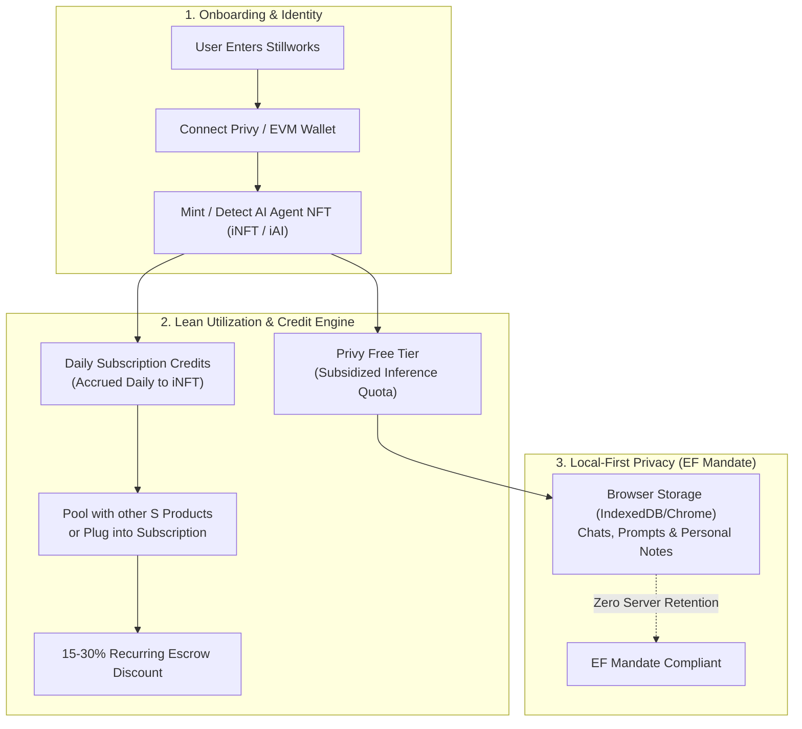
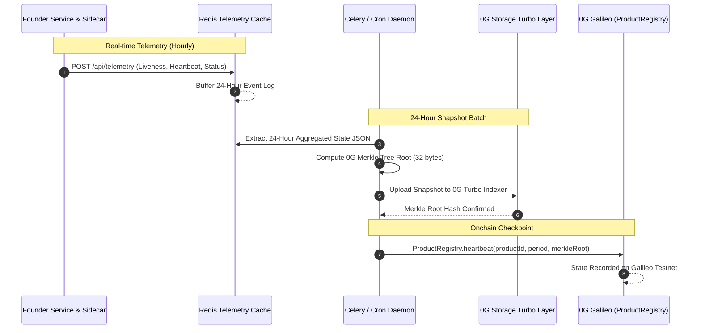

# STILLWORKS: USER LIFECYCLE, CROSS-COMPLIANCE & UPKEEP ARCHITECTURE

> **Authoritative Specification:** User Onboarding, Privy/iAI Lifecycle, Local-First Privacy, Redis Cache Telemetry, 24-Hour 0G Storage Snapshots, and Developer Operations Budget.
> **Standard Alignment:** Ethereum Foundation CROPS Mandate (`blog.ethereum.org/2026/03/13/ef-mandate`) & 0G Foundation Private Computer + Storage Turbo Track.

---

## 1. Executive Summary & Core Philosophy

Stillworks solves the dual dilemmas of modern software:
1. **Web2 SaaS Rent Extraction & Hostage Data:** Subscription fees compound, privacy is violated, and acquired products abruptly shut down with zero exit rails.
2. **Web3 Speculative Distraction:** Token-centric launchpads focus on hyper-financialization rather than reproducible, long-running sovereign software.

Stillworks creates a **lean, waste-free, sovereign commerce protocol**:
* **Identity & Free Tier:** Users onboard via Web3 private wallets (e.g., Privy embedded wallets or 0G iAI accounts). Holding an AI Agent NFT (iNFT) unlocks daily subscription credits and a zero-waste free tier.
* **Local-First Client Privacy:** Adhering strictly to the Ethereum Foundation Mandate, **all personal application data (chats, notes, workspace state, prompt logs) stays strictly inside the user's local browser environment (IndexedDB / localStorage)**.
* **Public Transparent Metadata:** Platform metadata (listings, subscription terms, heartbeat proofs, uptime scores, escrow transactions) is 100% public.
* **Storage & Caching Architecture:** Public operational telemetry lands in a lightweight in-memory cache (**Redis**). Every 24 hours (orchestrated by an autonomous Celery/sidecar worker), the aggregated state is compiled into a JSON snapshot, hashed into a **32-byte 0G Merkle Root**, and pinned immutably to **0G Storage Turbo Layer**.
* **Developer Operations Budget:** Each deployment maintains an onchain operations reserve funded from subscription deposits to autonomously sustain 0G storage gas and compute fees.

---

## 2. User Lifecycle & The iAI / Privy AgentPass



### 2.1 Onboarding & iai.finance ComFi Integration
1. **Wallet Connection:** Users sign in via Privy embedded wallets or standard EVM wallets (MetaMask, Rabby).
2. **Infinite AI (iAI) by iai.finance:**
   - **Contract on 0G Chain:** `0xc77FBd3824cc68e612b26114D176879aDdc29463`
   - **Protocol Architecture:** Flagship product of **Compute Finance (ComFi)** on 0G.
   - **Staking Mechanics:** Users stake native 0G via **Ascend** (liquid staking layer) to receive `a0G`, then deposit `a0G` on [iai.finance](https://iai.finance/) to mint and stake `iAI`.
   - **Daily Compute Yield:** Unlike speculative tokens, staking `iAI` generates **~1.271 AI compute credits per day per iAI**, which can be spent directly on the 0G Private Computer and Stillworks escrow fees.
   - **Agent Token Launchpad:** Associated pools and agent positions trade on [comfy.fun](https://comfy.fun/).
3. **Dedicated Privy Free Tier:** Privy wallet holders receive an initial subsidized inference quota. Users can test Stillworks software modules without burning their personal credits or 0G tokens.

### 2.2 Credit Accrual, Pooling & Subscription Discounts
* **Waste-Free Subscription Rebates:** By staking or connecting their `iAI` position to Stillworks, the daily 1.271 compute credit yield automatically offsets the recurring escrow billing in `SubscriptionEscrow.sol`.
* **S-Product Pooling:** Users can delegate their `iAI` compute yield to a common pool supporting multiple "S Products" (Sovereign Software products listed on Stillworks) or stake it directly into an active subscription for a **15–30% discount**.
* **Community Treasury Routing:** Unused compute credits can be routed into a shared community treasury on `comfy.fun`, earning loyalty rebates while subsidizing inference for open-source software developers.

---

## 3. Privacy Architecture: Strict EF CROPS Mandate Compliance

The **Ethereum Foundation Mandate** dictates:
> *"Keys and personal data on user device, or README says why not."*

Stillworks enforces a strict bifurcated data model:

```
┌────────────────────────────────────────────────────────────────────────┐
│                   STILLWORKS DUAL-PLANE DATA MODEL                     │
├────────────────────────────────────┬───────────────────────────────────┤
│    PRIVATE PLANE (User Device)     │   PUBLIC PLANE (0G & Redis Cache) │
├────────────────────────────────────┼───────────────────────────────────┤
│ • Interactive chat history         │ • Product listing specifications  │
│ • User application prompt drafts   │ • Subscription pricing & periods  │
│ • Private workspace notes          │ • Founder heartbeat attestations  │
│ • Decrypted walkaway data files    │ • TEE verification request IDs    │
│ • Wallet private keys              │ • 0G Merkle root snapshots        │
│                                    │ • Escrow balance & invoice proofs │
├────────────────────────────────────┼───────────────────────────────────┤
│ Storage: Browser IndexedDB / local │ Storage: Redis Cache + 0G Storage │
└────────────────────────────────────┴───────────────────────────────────┘
```

1. **Zero Central Database:** No PostgreSQL, MySQL, or cloud database holds user personal records.
2. **Client-Side Persistence:** When a user interacts with private inference modules or audits code, the input payload and results are cached exclusively in the browser's local sandbox.
3. **No Third-Party Trackers:** Stillworks builds cleanly with zero telemetry, Google Analytics, or third-party tracking scripts.

---

## 4. Operational Telemetry, Redis Caching & 24-Hour 0G Storage Backups



### 4.1 Telemetry Aggregation (Redis)
* Real-time events (heartbeat pings, new passport proposals, compliance scores) are buffered in **Redis** (or stream KV cache).
* This provides sub-millisecond API response times for catalog browsing and real-time dashboard updates without needing heavy relational database infrastructure.

### 4.2 The 24-Hour Snapshot Cadence (Celery Daemon)
* An autonomous Celery/sidecar daemon executes every 24 hours (or hourly for high-frequency listings):
  1. Aggregates all public state changes into a canonical `snapshot-YYYY-MM-DD.json`.
  2. Builds the **0G Cryptographic Merkle Tree** across the chunked JSON data.
  3. Uploads the snapshot bundle to **0G Storage Turbo Layer** (`https://indexer-storage-testnet-turbo.0g.ai`).
  4. Posts the resulting 32-byte Merkle root hash onchain to `ProductRegistry.sol`.
* **Disaster Recovery:** If the Redis instance or API server vanishes, any node can fetch the latest 0G Storage Merkle root and rehydrate the entire state in seconds.

---

## 5. Developer Operations Budget & Upkeep Sustainability

To guarantee that autonomous 0G services remain permanently funded:

1. **Escrow Upkeep Reserve:**
   * When subscribers fund an agreement via `SubscriptionEscrow.sol`, a configurable operations slice (e.g., 2-5%) is automatically routed into the developer's **Operations Budget**.
   * Developers may also seed this reserve upfront during initial listing registration.
2. **Automated 0G Gas & Storage Sustenance:**
   * The developer's sovereign sidecar pulls gas subsidies from this operations budget to pay for 0G Storage Turbo pinning fees and 0G Galileo transaction fees.
   * If the operations budget falls below a safety threshold, the sidecar triggers an onchain alert, notifying the founder and subscribers.
3. **Upkeep Tasks:**
   * Generating periodic zero-knowledge / hashed service heartbeats.
   * Compiling and encrypting the latest PostgreSQL / application database dump (`pg_dump.tar.gz`).
   * Publishing the 0G Merkle root as the active `walkawayRoot` in `SubscriptionAgreement.sol`.

---

## 6. Implementation Map

| Component | File / Location | Responsibility |
| :--- | :--- | :--- |
| **AgentPass & Credit Module** | `app/src/components/AgentPassModule.tsx` | UI for iAI NFT status, Privy free tier, daily credits, pooling & local privacy indicators. |
| **Upkeep & Snapshot Monitor** | `app/src/components/UpkeepMonitor.tsx` | UI displaying Redis telemetry, Celery sync cadence, 24h 0G Storage snapshot hash, and Operations Budget. |
| **Main Application Hub** | `app/src/app/page.tsx` | Tabbed navigation connecting AI Pipeline, Storage Station, AgentPass, and Upkeep. |
| **Daily Upkeep Runner** | `scripts/sync-daily-snapshot.mjs` | Standalone autonomous script compiling state, computing Merkle root, and uploading snapshot to 0G Turbo. |
| **Heartbeat Daemon** | `scripts/heartbeat-daemon.mjs` | Sidecar daemon signing status proofs and broadcasting to 0G Galileo. |
