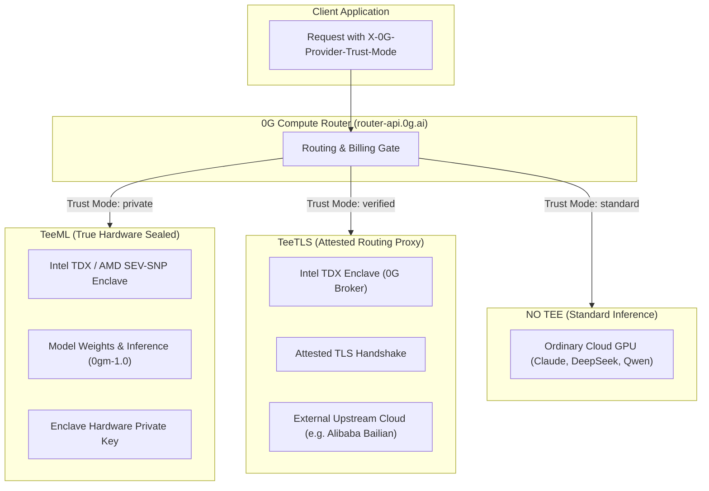

# 0G Ecosystem Architectural Capabilities & Hard Boundaries

**Author:** Scout-ZeroG-Capabilities (Firstmate Crew on Stillworks)  
**Target Audience:** Captain Shreyan, Cursor Lead Agent, Crew Engineers  
**Target Network:** 0G Galileo Testnet (Chain ID `16602`) & 0G Aristotle Mainnet (Chain ID `16661`)  
**Status:** Authoritative Architectural Boundary Report  
**Date:** Friday, November 6, 2026  

---

## 1. Executive Summary & Architectural Verdict

There is a prevalent misconception among developers encountering 0G (Zero Gravity) for the first time: assuming that because it is branded as the *"Decentralized AI Operating System (deAIOS)"*, it provides a decentralized cloud compute infrastructure capable of running arbitrary Docker containers, relational databases (PostgreSQL, MySQL), and backend microservices (like Railway, Render, or AWS ECS).

**The unvarnished architectural reality is:**

1. **0G is NOT a general-purpose container cloud (PaaS/VPS).** It cannot host Docker containers, run custom Express/FastAPI backends, or execute background daemons submitted by users.
2. **0G Compute is strictly an AI Model Serving & Training Marketplace.** It connects users to GPU providers exposing standardized OpenAI/Anthropic-compatible inference endpoints (`/chat/completions`, `/images/generations`, `/embeddings`, `/audio/transcriptions`, `/videos`) and distributed LoRA fine-tuning workers.
3. **0G Storage is NOT a dynamic web server.** It consists of an append-only, content-addressed **Log Layer** (Merkle-verified blob storage) and a mutable **Key-Value (KV) Layer**. It can host pure static web assets (`index.html`, JS bundles, WASM, CSS) and data blobs, but **cannot execute server-side Node.js, Python, dynamic SSR, or API routes (`/api/...`)**.
4. **0G Private Computer (TEE) provides sealed inference ONLY for specific models.** Out of 124 models available on the 0G router, **only 8 support TEE attestation**. Only **`0gm-1.0-35b-a3b`** (and niche decision/embedding models) runs in a true hardware-sealed enclave (`TeeML`). Popular frontier models like Claude, DeepSeek, and standard Qwen are un-attested (`NO TEE`) or proxied over TLS (`TeeTLS`). Requesting Claude with `X-0G-Provider-Trust-Mode: private` will fail closed.
5. **0G Chain has NO native cron or autonomous daemons.** Like Ethereum, 0G Chain is a standard EVM state machine (Cancun EVM). Smart contracts cannot self-awaken; all periodic actions (such as heartbeats or subscription settlement ticks) **must be triggered externally**.

---

## 2. Definitive Capabilities & Boundaries Matrix

| Workload / Capability | Supported on 0G? | 0G Subsystem | Execution Location / How It Operates | Required External Alternative (If Unsupported) |
| :--- | :---: | :--- | :--- | :--- |
| **Smart Contract Settlement** | ✅ **YES** | **0G Chain** (Galileo / Aristotle) | EVM Cancun execution on validator nodes. Solc 0.8.19+. Standard Solidity contracts. | N/A |
| **Static Frontend Hosting** | ✅ **YES** | **0G Storage** (Log Layer) | Static export (`out/`) uploaded via Turbo Indexer as Merkle-verified chunks. Retrieved via gateway. | IPFS / Arweave / Cloudflare Pages |
| **Immutable File / Blob Storage** | ✅ **YES** | **0G Storage** (Log Layer) | Append-only raw chunks (256KB), PoRA mining, retrieved by 32-byte Merkle root hash. | Filecoin / Arweave / S3 |
| **Mutable Key-Value State** | ✅ **YES** | **0G Storage** (KV Layer) | Stream-based log replay on specialized KV nodes. Sub-second read/write by stream key. | Redis / DynamoDB / Ceramic |
| **AI Text / Vision LLM Inference** | ✅ **YES** | **0G Compute / Private Computer** | OpenAI/Anthropic REST endpoints (`/chat/completions`) routed to decentralized GPU providers. | Groq / Together AI / OpenAI / Anthropic |
| **Hardware-Sealed TEE Inference** | ✅ **YES (Selective)** | **0G Private Computer** (`TeeML`) | Intel TDX / AMD SEV-SNP enclaves running `0gm-1.0-35b-a3b`, `laya`, `vela-2.0`. Output cryptographically signed. | Phala Network / Oasis Network |
| **AI Model LoRA Fine-Tuning** | ✅ **YES** | **0G Compute Network** | Distributed training tasks submitted to GPU worker clusters via broker contracts. | Modal / RunPod / AWS SageMaker |
| **Text-to-Image / Audio Transcription** | ✅ **YES** | **0G Compute / Private Computer** | Specialized endpoints (`/images/generations`, `/audio/transcriptions`) for Whisper, Z-Image-Turbo. | Replicate / Fal.ai |
| **Arbitrary Docker Container Hosting** | ❌ **NO** | *None* | 0G Compute does not expose a container runner or VM hypervisor for arbitrary user code. | **Railway, Render, Fly.io, Akash Network, AWS EC2** |
| **Relational SQL Database (Postgres)** | ❌ **NO** | *None* | 0G Storage KV is strictly key-value, not relational SQL. No SQL query engine or ACID joins. | **Supabase, Neon, Railway Postgres, Tableland** |
| **Custom Backend APIs (Express, NestJS)** | ❌ **NO** | *None* | Storage nodes cannot run Node.js/Python runtimes; Compute nodes only run AI models. | **Railway, Cloudflare Workers, Vercel Serverless, VPS** |
| **Next.js Server-Side Rendering (SSR)** | ❌ **NO** | *None* | Next.js server components and `/api/...` dynamic routes cannot run inside 0G Storage. | **Vercel, AWS ECS, Railway** (or export as pure static) |
| **Native Onchain Cron / Autonomous Daemon** | ❌ **NO** | *None* | 0G Chain contracts cannot self-execute or run background timers without external gas transactions. | **External Founder Daemon, Gelato Web3 Functions, Chainlink Automation** |

---

## 3. Deep Dive: 0G Compute Network

### 3.1 What 0G Compute Is
The 0G Compute Network is an open, decentralized GPU marketplace designed to break the monopoly of centralized AI cloud providers. It has two primary consumption models:

1. **0G Compute Router / Private Computer (`router-api.0g.ai` / `pc.0g.ai`):**  
   A managed API gateway that presents an OpenAI- and Anthropic-compatible interface. Developers pass an API key (`Authorization: Bearer sk-...`) and make standard REST calls. The router handles provider selection, load balancing, failover, and onchain billing deduction from the unified Payment Layer contract.
2. **Direct Serving Broker SDK (`@0gfoundation/0g-compute-ts-sdk`):**  
   A Web3-native client library where an Ethereum wallet interacts directly with onchain service discovery and settlement contracts. The application deposits funds into a global ledger, transfers an allocation into a provider sub-account, generates cryptographic authentication headers for each prompt, and calls `broker.inference.processResponse(...)` to settle fees.

### 3.2 Service Types Supported by the Broker SDK
The SDK (`@0gfoundation/0g-compute-ts-sdk` v0.9.0) explicitly enumerates the following fixed service endpoints:

```
┌────────────────────┬──────────────────────────────────┬─────────────────────────────┐
│ serviceType        │ REST Endpoint Path               │ processResponse() Support   │
├────────────────────┼──────────────────────────────────┼─────────────────────────────┤
│ chatbot            │ POST /chat/completions           │ Supported (Header / Body)   │
│ text-to-image      │ POST /images/generations         │ Supported (Header only)     │
│ image-editing      │ POST /images/edits               │ Supported (Header only)     │
│ speech-to-text     │ POST /audio/transcriptions       │ Supported (Header / Body)   │
│ embedding          │ POST /embeddings                 │ THROWS "Unknown service"    │
│ video-generation   │ POST /videos (async polling)     │ THROWS "Unknown service"    │
└────────────────────┴──────────────────────────────────┴─────────────────────────────┘
```

> [!WARNING]
> **Broker SDK `processResponse()` Limitation:**  
> The internal response extractor in SDK 0.9.0 switches strictly on `chatbot`, `text-to-image`, `image-editing`, and `speech-to-text`. Calling `processResponse()` for `embedding` or `video-generation` throws an unhandled error (`Error: Unknown service type`). For embedding workloads, requests must bypass `processResponse()`.

### 3.3 Why 0G Compute CANNOT Host Docker / Databases / APIs
- **No User-Facing Container Runtime:** There is no CLI or API in 0G (e.g. `0g run`, `0g deploy container`, or Kubernetes manifest submission) allowing a developer to deploy arbitrary code.
- **Provider-Side Docker Only:** The only place Docker is used in 0G is by GPU node operators who run the `0g-serving-broker` software and confidential model containers (using `sigstore` verification and Intel TDX enclaves) to serve specific, registered AI weights.
- **Strict Input/Output Schema:** All Compute nodes only accept inference request payloads (prompts, image parameters, audio bytes) conforming to OpenAI schemas and return model completions. They do not expose open network ports, persistent disk volumes, or background process loops.

---

## 4. Deep Dive: 0G Storage Architecture

0G Storage is a modular, high-throughput data availability (DA) and storage layer composed of two distinct tiers:

```
┌────────────────────────────────────────────────────────┐
│             0G Storage Key-Value (KV) Layer            │
│  • Mutable key-value state indexed by stream ID & key  │
│  • Millisecond lookups for agent state & embeddings    │
├────────────────────────────────────────────────────────┤
│             0G Storage Log Layer (Base Tier)           │
│  • Append-only, raw unstructured blob storage (PoRA)   │
│  • Split into 256KB chunks in a Merkle tree            │
│  • Identified strictly by 32-byte Merkle root hash     │
├────────────────────────────────────────────────────────┤
│                 0G Consensus / Chain                   │
│  • Data Availability proofs & flow contract settlement │
└────────────────────────────────────────────────────────┘
```

### 4.1 The Log Layer (Append-Only Blobs)
- **Upload Flow:** Files or buffers are processed into a `ZgFile`, divided into 256KB chunks, and compiled into a Merkle tree to compute the 32-byte root hash. The indexer coordinates chunk submission across decentralized storage nodes, and an onchain transaction settles the storage fee in 0G tokens.
- **Immutability:** Chunks are permanently sealed and verifiable via Merkle proofs. Data cannot be modified in place. Any update produces an entirely new 32-byte root hash.
- **Retrieval:** Content-addressed via indexers:
  ```http
  GET https://indexer-storage-testnet-turbo.0g.ai/file/<32-byte-root-hash>
  ```
- **Known Live Fact:** The testnet storage RPC `storagerpc-testnet.0g.ai` does not resolve. All testnet storage operations must target the Turbo Indexer (`indexer-storage-testnet-turbo.0g.ai`) combined with the 0G Galileo chain RPC (`https://evmrpc-testnet.0g.ai`).

### 4.2 The Key-Value (KV) Layer (`0g-storage-kv`)
- **Purpose:** Solves the immutability bottleneck of the Log Layer by providing mutable key-value access.
- **Architecture:** An application writes state mutations into a specific *stream ID*. Dedicated KV nodes monitor the 0G Storage Log Layer, consume mutation events, and replay them locally into a state snapshot.
- **Access Patterns:** Read/write by `(streamId, key)`.
- **Boundaries:** 
  - It is **strictly a key-value store** (analogous to Redis GET/SET or DynamoDB).
  - It has **no SQL engine**: no `SELECT ... WHERE`, no table joins, no foreign keys, no secondary index query planner, and no stored procedures.
  - It cannot replace relational databases like PostgreSQL.

### 4.3 Web Hosting Boundaries on 0G Storage
Can you host a website on 0G Storage?
- **Static Export (`output: 'export'`):** **YES.** Next.js, Vite, React, or vanilla HTML/JS bundles can be compiled into static files and uploaded as a bundle to 0G Storage. Browsers can load these assets directly from an indexer gateway or decentralized domain gateway (ENS / DNSLink).
- **Dynamic Node.js / SSR / API Routes:** **NO.** 0G Storage nodes are storage daemons (handling Proof of Random Access). They do not run a Node.js runtime. If your Next.js app has server-side components relying on Node headers or dynamic API routes (`/api/auth`, `/api/db`), **those routes will fail completely when hosted on 0G Storage**.

---

## 5. Deep Dive: 0G Private Computer (TEE) & Trust Modes

0G Private Computer ([pc.0g.ai](https://pc.0g.ai)) is the confidential inference utility of the 0G ecosystem.

### 5.1 Verification Modes: The Two Meanings of "TEE" in 0G
0G documentation and live router metadata distinguish three distinct trust modes via the `X-0G-Provider-Trust-Mode` header:



1. **`TeeML` (`X-0G-Provider-Trust-Mode: private`):**
   - **True Sealed Enclave:** The open-weight model runs *entirely inside* a hardware enclave (Intel TDX or AMD SEV-SNP managed via `dstack`).
   - **Privacy Guarantee:** Enclave memory is encrypted in hardware. Neither the node operator, the host OS root, nor 0G Foundation can intercept user prompts or model activations.
   - **Attestation:** The enclave cryptographically signs the output.
2. **`TeeTLS` (`X-0G-Provider-Trust-Mode: verified`):**
   - **Attested Proxy:** The model does *not* execute inside a TEE. Instead, the 0G Broker runs in a TEE, establishes a secure TLS connection to an external upstream API provider (such as Alibaba Cloud Bailian), and signs a cryptographic receipt verifying that the request was forwarded untampered.
   - **Privacy Warning:** The upstream provider receives the prompt in cleartext.
3. **`NO TEE` (`X-0G-Provider-Trust-Mode: standard`):**
   - Standard un-attested cloud inference with ordinary API privacy terms.

### 5.2 Live Model Audit: 124 Models Inspected
A live audit of the active model catalogue on `https://router-api.0g.ai/v1/models` reveals **124 total models**, but only **8 support TEE verification**:

```
┌──────────────────────────┬──────────────────┬───────────────┬──────────┬──────────┬─────────┬──────────────────────┐
│ Model ID                 │ Service Type     │ Verifiability │ Enclave  │ Verifier │ Context │ Supported Formats    │
├──────────────────────────┼──────────────────┼───────────────┼──────────┼──────────┼─────────┼──────────────────────┤
│ 0gm-1.0-35b-a3b          │ chatbot          │ TeeML         │ TDX      │ dstack   │ 262,144 │ openai, anthropic    │
│ laya                     │ decisions        │ TeeML         │ TDX      │ dstack   │ 512     │ openai               │
│ vela-2.0-9b              │ decisions        │ TeeML         │ TDX      │ dstack   │ 16,384  │ openai               │
│ whisper-large-v3         │ speech-to-text   │ TeeML         │ TDX      │ dstack   │ 448     │ openai               │
│ qwen3-embedding-0.6b     │ embedding        │ TeeML         │ TDX      │ dstack   │ 32,768  │ openai               │
│ qwen3-embedding-8b       │ embedding        │ TeeML         │ TDX      │ dstack   │ 32,768  │ openai               │
│ z-image-turbo            │ text-to-image    │ TeeML         │ TDX      │ dstack   │ 2,048   │ openai               │
│ qwen3.7-text-embedding   │ embedding        │ TeeTLS        │ TDX      │ dstack   │ 128,000 │ openai               │
└──────────────────────────┴──────────────────┴───────────────┴──────────┴──────────┴─────────┴──────────────────────┘
```

> [!CRITICAL]
> **The Frontier Model Trap (Claude / DeepSeek):**  
> Every Claude model (`claude-fable-5`, `claude-haiku-5.5`, `claude-opus-4-8`, `claude-sonnet-4.5/5/5.5`) and DeepSeek model (`deepseek-v4-flash`, `deepseek-v4-pro`) on the 0G router is flagged as **`NO TEE`** (`tee_attested: false`).  
> **If an application sets `X-0G-Provider-Trust-Mode: private` and requests `claude-sonnet-5` or `deepseek-v4-pro`, the 0G router will reject the request (fail closed).**  
> For sealed chatbot reasoning with authentic hardware attestation, **`0gm-1.0-35b-a3b` is the ONLY model supported**.

### 5.3 Billing & Settlement Architecture
- **Payment Layer Contract:**
  - **Galileo Testnet:** `0x0AD9690e0b34aB2d493DE02cDF149ee34f6C9939`
  - **Aristotle Mainnet:** `0xA3b15Bd2aD18BFB6b5f92D8AA9F444Dd59d1cE32`
- **Unit of Account:** Quoted in *neurons* ($1\text{ 0G} = 10^{18}\text{ neurons}$, identical to wei). Billed strictly per-token on prompt and completion.
- **Deposit Mechanism:** Users call `deposit()` on the Payment Layer contract with native 0G tokens. Once funded, API keys (`sk-...`) can be minted on `pc.0g.ai` or `pc.testnet.0g.ai`.
- **Zero Subscriptions:** Pure pay-as-you-go micro-deductions. If onchain balance is 0, the router returns `HTTP 402 Insufficient Balance`.
- **Trace ID vs Attestation:** The router returns `X-Request-ID` (and `x_0g_trace.request_id` in response bodies). This is a **usage history billing reconciliation ID**. It can be written into onchain invoices for verifiable accounting, but is separate from the enclave's cryptographic signature.

---

## 6. Deep Dive: Autonomous Execution & Cron Schedulers

### 6.1 The Myth of On-Chain Background Tasks
A frequent question is: *"Can 0G run cron schedulers or autonomous daemons natively onchain?"*

**The absolute answer is NO.**

- **EVM State Machine Invariant:** 0G Chain is a standard Cancun EVM blockchain. In the EVM architecture, smart contracts are completely passive state transitions. Code executes *if and only if* an externally owned account (EOA) or transaction submits a gas-paying call in a block.
- **No Native Cron Engine:** There is no internal clock interrupt, autonomous timer, or native keeper built into 0G Chain validator consensus. Contracts cannot execute themselves on a schedule.

### 6.2 How Periodic Tasks Must Be Architected in 0G
Any decentralized protocol requiring recurring automation (such as founder liveness heartbeats, pro-rata subscription escrow releases, or state compaction) must rely on one of three architectural patterns:

1. **Standalone External Sovereign Daemon (Recommended for Stillworks):**  
   A lightweight Node.js or Go script running on the founder's server, a local machine, or an autonomous agent worktree. It wakes up on an OS timer (Linux `cron` / `systemd`), checks system state, and signs an onchain transaction (e.g. `ProductRegistry.heartbeat(...)`).  
   *In Stillworks, terminating this external daemon is precisely what triggers the "Kill-Switch" demo event!*
2. **Decentralized Keeper Network:**  
   Off-chain bots (such as Gelato Network Web3 Functions or Chainlink Automation) monitor an onchain view function (e.g. `isRefundClaimable(agreementId)`). When true, the keeper submits a transaction and is reimbursed via a gas bounty.
3. **Public Cranks (Incentivized User Settlement):**  
   The smart contract allows any user or arbitrageur to trigger the settlement function, offering a small token reward or passing the gas burden to the counterparty (e.g. users calling `claimRefund()` when a heartbeat is missed).

---

## 7. Concrete Architectural Blueprint for Stillworks

Based on these hard technical boundaries, here is the exact, uncompromised architecture for **Stillworks** to win the **ETHGlobal Hackathon** and qualify for the **EF Best CROPS App** prize ($2,500) and **0G Prizes**:

```mermaid
flowchart TD
    subgraph Browser_Storefront["1. User Storefront (100% Client-Side)"]
        UI["Stillworks Static dApp (Next.js Static Export)"]
        WAGMI["Wagmi v2 / Viem Wallet Client"]
        STORAGE_SDK["@0gfoundation/0g-storage-ts-sdk (MemData)"]
        PC_CLIENT["0G PC Client (OpenAI Shape)"]
    end

    subgraph ZeroG_Decentralized_Stack["2. 0G Decentralized Stack"]
        subgraph Chain_Layer["0G Chain (Galileo 16602)"]
            PR["ProductRegistry.sol (Heartbeats & Passports)"]
            SE["SubscriptionEscrow.sol (Automated Refunds)"]
            SA["SubscriptionAgreement.sol (Terms & Exit Bundles)"]
        end

        subgraph Storage_Layer["0G Storage Turbo Layer"]
            IDX["indexer-storage-testnet-turbo.0g.ai"]
            STATIC_ROOT["Static Frontend Bundle Root"]
            PASSPORTS["Product Passports (JSON)"]
            WALKAWAY["Encrypted Walkaway Bundles (AES/ECIES)"]
        end

        subgraph Compute_Layer["0G Private Computer (TEE)"]
            ROUTER["router-api.0g.ai / testnet"]
            MODEL["0gm-1.0-35b-a3b (TeeML Enclave)"]
        end
    end

    subgraph Founder_Operations["3. External Operations (Off-Chain)"]
        DAEMON["Founder Heartbeat Daemon (heartbeat-daemon.mjs)"]
        LOCAL_SERVICE["Founder Software / SaaS API"]
    end

    STATIC_ROOT -.->|Loaded via Gateway| UI
    UI -->|1. Direct JSON-RPC Read/Write| PR
    UI -->|2. Escrow Funding & Refunds| SE
    UI -->|3. Fetch Passports & Bundles| IDX
    UI -->|4. Verifiable CROPS Audit (Trust: private)| ROUTER
    ROUTER --> MODEL
    DAEMON -->|Check /healthz| LOCAL_SERVICE
    DAEMON -->|Periodic heartbeat(id, period, proof)| PR
```

### Actionable Guidance for Captain Shreyan & Cursor

1. **Do NOT Attempt to Deploy a Backend to 0G:**  
   0G cannot host an Express server, Docker image, or database. Stillworks must maintain a **Zero-Backend Architecture** for the user storefront. The Next.js app must be built with `output: 'export'` and hosted statically on 0G Storage.
2. **Purge `/api/...` Routes from Frontend Bundles:**  
   In `app/src/components/StorageExplorer.tsx` and `ComputeAuditor.tsx`, replace any internal `fetch('/api/...')` calls with direct client-side SDK calls (`MemData.merkleTree()`, `indexer.downloadToBlob()`, and direct `fetch(ROUTER_BASE_URL)`).
3. **Pin the TEE Model to `0gm-1.0-35b-a3b`:**  
   When performing TEE compliance audits, configure the client to call `0gm-1.0-35b-a3b` with header `X-0G-Provider-Trust-Mode: private`. Do not attempt to use Claude or DeepSeek for TEE-sealed claims, as they are not TEE-attested.
4. **Heartbeat Bot Runs as a Sovereign External Script:**  
   Implement the founder liveness bot as a standalone script (`scripts/heartbeat-daemon.mjs`). It pings the software's local endpoint and submits `heartbeat(productId, period, proof)` to 0G Galileo. If the founder turns off the bot, the escrow contract automatically unlocks pro-rata refunds for subscribers.

---

## 8. Summary Conclusion

| Dimension | What 0G Is | What 0G Is NOT |
| :--- | :--- | :--- |
| **Compute** | Decentralized GPU inference & fine-tuning for AI models | Container hosting, Docker PaaS, or dynamic API server |
| **Storage** | Merkle-verified blob DA & sub-second Key-Value store | Node.js web runtime or relational SQL database |
| **Privacy (TEE)** | Hardware-sealed inference for `0gm-1.0` & decision models | Hardware enclaves for proprietary frontier models (Claude/DeepSeek) |
| **Automation** | Passive EVM blockchain triggered by external gas calls | Native onchain cron scheduler or background daemon runner |

This boundary clarity preserves the architectural integrity of Stillworks, guarantees strict alignment with the Ethereum Foundation CROPS criteria, and prevents dead-end engineering pursuits on 0G infrastructure.
