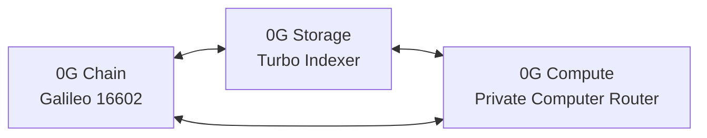

# 0G Infrastructure & Agent Connection Blueprint

**Target Network:** 0G Galileo Testnet (Chain ID `16602`)  
**Status:** Initialized (Deployer Wallet Funded with 0.1 0G)  
**Last Verified:** Nov 6, 2026, 02:02 IST  

---

## 1. Deployed Wallet & Identity

| Property | Value |
| :--- | :--- |
| **Public Address** | `0x237eA22D38a1e20EC50b39711014B9C87dBb21c7` |
| **Galileo Testnet Balance** | `0.1 0G` (`100000000000000000` wei) — Verified live |
| **Private Key** | Stored locally in `.env` (`PRIVATE_KEY`) — Untracked by git |
| **Explorer Link** | [chainscan-galileo.0g.ai/address/0x237eA22D...](https://chainscan-galileo.0g.ai/address/0x237eA22D38a1e20EC50b39711014B9C87dBb21c7) |

---

## 2. 0G Tri-Layer Architecture

Stillworks utilizes the complete 0G decentralized stack:

### A. 0G Chain (Settlement & Liveness Verification)
- **RPC:** `https://evmrpc-testnet.0g.ai`
- **Chain ID:** `16602` (`0x40EA`)
- **Block Explorer:** `https://chainscan-galileo.0g.ai`
- **Faucet:** `https://faucet.0g.ai` (0.1 0G/day)
- **Core Contracts:**
  - `ProductRegistry.sol`: Sovereign tool listings, passport Merkle roots, founder heartbeats.
  - `SubscriptionAgreement.sol`: Terms, pricing, grace windows, walkaway bundle roots.
  - `SubscriptionEscrow.sol`: Holds user deposits; releases per period; automated pro-rata refund on missed heartbeat.
  - `Deploy Script`: `contracts/script/DeployGalileo.s.sol`

### B. 0G Storage (RAG Knowledge & Exit Bundles)
- **Storage Indexer:** `https://indexer-storage-testnet-turbo.0g.ai`
- **Storage RPC:** `https://storagerpc-testnet.0g.ai`
- **SDK Package:** `@0gfoundation/0g-storage-ts-sdk`
- **Critical Dependency Pin:** `ethers@6.13.1` (exact pin required by storage SDK)
- **Use Cases:**
  - Pinned product passports (JSON).
  - RAG knowledge bases and application runtime configs.
  - Periodically updated encrypted walkaway bundles (AES-256 / ECIES).

### C. 0G Compute (Private Computer / Inference Utility)
- **Router Endpoint:** `https://router-api-testnet.integratenetwork.work/v1`
- **Web Dashboard:** `https://pc.testnet.0g.ai`
- **Payment Layer Contract:** `0x0AD9690e0b34aB2d493DE02cDF149ee34f6C9939`
- **Inference Client:** Standard OpenAI-compatible client pointed at base URL.
- **Header Enforcements:**
  - `X-0G-Provider-Trust-Mode: private` (TEE-sealed inference)
  - `X-Request-ID` / `x_0g_trace.request_id` (extracted and linked to onchain invoices)

---

## 3. Multi-Agent Connection Matrix

| Agent | Assigned Branch | Connection Points | Core Focus |
| :--- | :--- | :--- | :--- |
| **Cursor** | `cursor` | All 3 layers via `.cursorrules` & `.0g-skills` | Primary coordination clearinghouse, decision routing |
| **Anti-Gravity** | `anti-gravity` | 0G Chain RPC, Foundry broadcast, DeployGalileo | Compilation, deployment harness, gas simulation |
| **FreeBuf** | `freebuf` | 0G Storage Turbo Indexer, 0G PC Router | Security audits, RAG data integrity, TEE headers |

---

## 4. Official 0G Skill Integration

The official 0G Builder Hub agent skills have been integrated into `./.0g-skills`:
- Quick reference: `./.0g-skills/patterns/NETWORK_CONFIG.md`
- Storage patterns: `./.0g-skills/skills/storage/`
- Compute patterns: `./.0g-skills/skills/compute/`
- Chain patterns: `./.0g-skills/skills/chain/`
