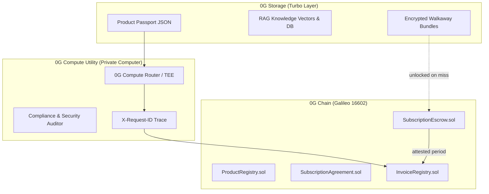

# POSO: Proof of Sovereign Operation Protocol Specification

**Protocol:** Proof of Sovereign Operation (POSO) for Stillworks  
**Context:** ETHGlobal Mumbai 2026 — CROPS & 0G Deep Tech Track  
**Network:** 0G Galileo (16602) · 0G Storage Turbo · 0G Private Computer  

---

## 1. Architectural Philosophy

Proof of Sovereign Operation (POSO) establishes a verifiable contract between autonomous software operators and subscribers:
1. **No Hostage Data:** Software state and RAG knowledge bases are stored on 0G Storage, cryptographically bound by Merkle roots.
2. **Neutral Escrow Rails:** Subscriber deposits remain in `SubscriptionEscrow` on 0G Chain, released only when periodic heartbeat attestations prove operational liveness.
3. **Verifiable Compute Utility:** AI inference (audits, scoring, task execution) runs on 0G Private Computer in TEE-sealed mode, logging immutable `X-Request-ID` traces.
4. **Instant Exit Guarantee:** If the host server or domain goes dark past the grace window, remaining funds refund automatically and the encrypted walkaway bundle unlocks.

---

## 2. Infrastructure Layer Breakdown

### Layer A: 0G Storage (Data & RAG Utility)
- **Indexer:** `https://indexer-storage-testnet-turbo.0g.ai`
- **Upload path:** `https://indexer-storage-testnet-turbo.0g.ai` plus `https://evmrpc-testnet.0g.ai`
- **Package:** `@0gfoundation/0g-storage-ts-sdk` with `ethers@6.13.1`
- **Operation:**
  - Ingests application docs, passports, and RAG knowledge state.
  - Generates immutable 32-byte Merkle roots stored in `ProductRegistry`.

### Layer B: 0G Compute (Private AI & Model Inference)
- **Router:** `https://router-api-testnet.integratenetwork.work/v1`
- **Dashboard:** `https://pc.testnet.0g.ai`
- **Payment Layer:** `0x0AD9690e0b34aB2d493DE02cDF149ee34f6C9939`
- **Trust Mode:** `X-0G-Provider-Trust-Mode: private` (TEE-sealed)
- **Operation:**
  - Audits product passport compliance against CROPS standards.
  - Returns cryptographically traceable `X-Request-ID` passed into onchain invoices.

### Layer C: 0G Chain (Settlement & Liveness Verification)
- **Chain ID:** `16602`
- **RPC:** `https://evmrpc-testnet.0g.ai`
- **Contracts:**
  - `ProductRegistry.sol`: Founder registry, steward approvals, periodic heartbeat attestations.
  - `SubscriptionAgreement.sol`: Terms agreement, pricing, grace windows.
  - `SubscriptionEscrow.sol`: Holds locked user capital; pro-rata release on heartbeat, instant refund on miss.

---

## 3. Step-by-Step Implementation Sequence

1. **Step 1: Infrastructure & Storage Foundation (Current):**
   - Bind deployer wallet `0x237eA22D38a1e20EC50b39711014B9C87dBb21c7` (0.1 0G funded).
   - Establish `.0g-skills` SDK patterns and environment bindings.
   - Stage RAG document schema and passport JSON layout for 0G Storage.

2. **Step 2: Private Models & Compute Integration:**
   - Connect 0G Private Computer broker client.
   - Deposit testnet credits to Payment Layer (`0x0AD9690e...`).
   - Wire passport audit agent with `X-Request-ID` extraction.

3. **Step 3: Escrow & Application Storefront:**
   - Connect static client (no backend server).
   - Implement live demo kill-switch rehearsal (kill founder server $\rightarrow$ claim refund $\rightarrow$ download walkaway bundle).
