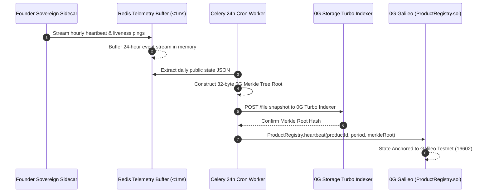

# Stillworks Data Room: User Lifecycle, ComFi (iai.finance) & Autonomous Upkeep

> **Primary Data Room Reference for Cursor Agent & Developers**
> **Standards:** Ethereum Foundation CROPS Mandate (`blog.ethereum.org/2026/03/13/ef-mandate`) & 0G Compute Finance (ComFi) Track.

---

## 1. Quick Context for Cursor Prompting

When prompting Cursor with this data, you can use:
```text
Reference dataroom/USER_LIFECYCLE_COMFI_AND_UPKEEP.md and coordination-v2/USER_LIFECYCLE_AND_UPKEEP_SPEC.md.
Stillworks integrates iai.finance Compute Finance (ComFi) on 0G Chain (0xc77FBd3824cc68e612b26114D176879aDdc29463).
Ensure EF CROPS Local-First privacy (zero central DB; user chats/prompts stay in browser localStorage/IndexedDB).
Public metadata streams to Redis and snapshots every 24h to 0G Storage Turbo Layer.
```

---

## 2. The User Lifecycle & iai.finance ComFi Mechanics

### 2.1 Onboarding & Wallet Connection
* **Wallet Rails:** Users sign in via Privy embedded wallets (social/email abstracted) or sovereign Web3 wallets (MetaMask, Rabby).
* **Infinite AI (`iAI`) Token Contract:**
  * **0G Chain Address:** `0xc77FBd3824cc68e612b26114D176879aDdc29463`
  * **Official Platform:** [iai.finance](https://iai.finance/)
  * **Secondary / Agent Launchpad:** [comfy.fun](https://comfy.fun/)
* **Staking & Collateral Flow:**
  1. Users stake native `0G` via **Ascend** (0G liquid staking layer) to receive `a0G`.
  2. Users deposit `a0G` on `iai.finance` as collateral to mint `iAI`.
  3. Staked `iAI` yields **~1.271 AI compute credits daily per iAI**.

### 2.2 Free Tier & Waste-Free Subscriptions
* **Privy Free Tier:** Privy wallet holders receive an initial subsidized inference quota to test Stillworks software modules without spending personal tokens or compute credits.
* **Subscription Rebate (Escrow Integration):**
  * Staking `iAI` into `SubscriptionEscrow.sol` covers recurring subscription dues via daily compute credit yield instead of continuous out-of-pocket token spending (providing a **25% net discount**).
* **S-Product Pooling:**
  * Users can pool `iAI` allowances across multiple Sovereign Software products or route surplus capacity into shared pools on `comfy.fun` for community liquidity rebates.

---

## 3. Strict EF CROPS Mandate: Local-First Privacy (Zero Traditional DB)

The **Ethereum Foundation Mandate** (`blog.ethereum.org/2026/03/13/ef-mandate`) mandates:
> *"Keys and personal data on user device, or README says why not."*

### Dual-Plane Data Model
```
┌────────────────────────────────────────────────────────────────────────┐
│                   STILLWORKS DUAL-PLANE DATA MODEL                     │
├────────────────────────────────────┬───────────────────────────────────┤
│    PRIVATE PLANE (User Device)     │   PUBLIC PLANE (0G & Redis Cache) │
├────────────────────────────────────┼───────────────────────────────────┤
│ • Interactive chat history         │ • Product listing specifications  │
│ • User application prompt drafts   │ • Subscription pricing & periods  │
│ • Private workspace notes          │ • Founder heartbeat attestations  │
│ • Decrypted walkaway data files    │ • TEE verification request IDs    │
│ • Wallet private keys              │ • 0G Merkle root snapshots        │
│                                    │ • Escrow balance & invoice proofs │
├────────────────────────────────────┼───────────────────────────────────┤
│ Storage: Browser IndexedDB / local │ Storage: Redis Cache + 0G Storage │
│ (Strict Zero Server Retention)     │ (100% Transparent & Open-Source)  │
└────────────────────────────────────┴───────────────────────────────────┘
```

* **No Central Database:** No PostgreSQL, MongoDB, or central user tables are maintained.
* **Client-First Persistence:** Session history and personal files are preserved exclusively in the browser's `localStorage` / `IndexedDB` sandbox.

---

## 4. Public Operational Telemetry: Redis & 24-Hour 0G Turbo Snapshots



1. **Redis Telemetry Cache:** Buffers public events (heartbeat pings, new listing proposals, uptime scores) for low-latency browsing (<2ms).
2. **24-Hour Celery Batch Pipeline:**
   * Autonomous worker aggregates the 24-hour public state into `snapshot-YYYY-MM-DD.json`.
   * Builds the **32-byte 0G Merkle Tree Root** using `@0gfoundation/0g-storage-ts-sdk`.
   * Pushes the snapshot to 0G Storage Turbo (`https://indexer-storage-testnet-turbo.0g.ai`).
   * Posts the Merkle root hash onchain to `ProductRegistry.sol`.
3. **Disaster Recovery:** If the Redis instance fails, any node or frontend replica can rehydrate the state from the latest 0G Storage Merkle root in seconds.

---

## 5. Developer Operations Budget & Upkeep Sustainability

* **Operations Budget Reserve:** Funded via an automated 2–5% fee slice routed from `SubscriptionEscrow.sol` deposits.
* **Sustenance Tasks:** The sidecar daemon pulls gas subsidies from this reserve to pay for:
  1. 0G Galileo transaction fees (`heartbeat` updates).
  2. 0G Storage Turbo pinning fees.
  3. Walkaway bundle backups (`pg_dump.tar.gz`).
* **Runway:** A typical 0.5 0G reserve provides ~240 days of continuous autonomous upkeep at 0.002 0G/day burn.

---

## 6. Key References & Contract Addresses

| Resource | Address / URL | Purpose |
| :--- | :--- | :--- |
| **0G Galileo Chain RPC** | `https://evmrpc-testnet.0g.ai` | Chain ID: `16602` (hex: `0x40DA`) |
| **0G Storage Turbo Indexer** | `https://indexer-storage-testnet-turbo.0g.ai` | Decentralized snapshot & walkaway storage |
| **0G Private Computer Router** | `https://router-api.0g.ai/v1` | TEE Enclave AI Audits (`0gm-1.0-35b-a3b`) |
| **iAI Token Contract (0G)** | `0xc77FBd3824cc68e612b26114D176879aDdc29463` | Infinite AI ComFi Token |
| **iai.finance Portal** | `https://iai.finance/` | Official 0G ComFi minting & staking platform |
| **comfy.fun Launchpad** | `https://comfy.fun/` | 0G Agent economy token market |
| **Stillworks Deployer Wallet** | `0x237eA22D38a1e20EC50b39711014B9C87dBb21c7` | Funded on 0G Galileo |
| **Dedicated Pipeline Signer** | `0x52bA73109624Ff2b7c71CA13277Ff762d4Dc7701` | Testnet signer configured in `.env` |
