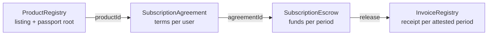
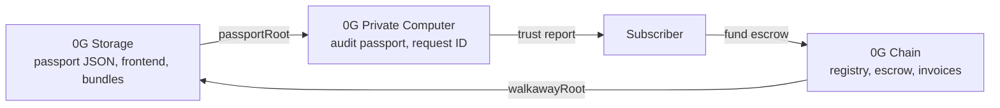

<!-- Source: canvas b1c77045-8ce3-4613-9165-74301a26bfab, https://cursor.com/canvas/store-06dd6927-e24f-45af-95a0-cbaa5e74b995/b1c77045-8ce3-4613-9165-74301a26bfab — converted faithfully from page source Thu Nov 5 2026 ~10:55 PM IST. Competitor matrix shows all 28 rows (the page's segment filter is UI-only). -->
# Sovereign Software — ETHGlobal Mumbai Data Room

> Stillworks: a CROPS consumer storefront with escrow rails. What it is, what we build in Mumbai and where it stops, the four contracts, how 0G Chain, Storage and Private Computer fit together, and what could list today.

## Contents
- What this is (and is not)
- The one solid CROPS hit
- What we build / where it stops
- Contracts required
- How 0G systems collaborate
- User and founder lifecycle
- Heartbeat and OPPO passport compliance scoring
- Invoice lifecycle (non-arbitrary)
- Management, proposal and request layer
- Stewardship
- Possibilities: apps that could list today
- Deploy vs existing products
- Agent-tax, x402 and replicability angle
- Build method and workstreams
- Problem
- CROPS README draft
- EF CROPS bounty checklist
- 0G bounty checklist
- Arkiv track
- Competitor matrix
- Positioning
- Demo video script
- Risks and tradeoffs
- Better sections for later
- Sources

## What this is (and is not)

| Is it a… | Answer |
|---|---|
| Payments platform? | No. Escrow and invoices are rails inside the store; we never act as merchant of record or hold funds custodially. |
| Consumer platform? | Yes, first. The buyer is a person subscribing to a newsletter, analytics or scheduling tool, and the UX is written for them. |
| Product Hunt? | No. No upvotes or launch day; ranking comes from passport completeness, heartbeat uptime and escrow health. |
| CROPS app? | Yes. It is a custodian of open, private, secure applications whose storefront itself survives losing our domain and servers. |
| Just an app? | No. It is a storefront plus four contracts any frontend can read; the app is one client of the protocol. |

- **What it is:** A CROPS consumer storefront with escrow rails: custodian of open, private and secure applications. Payments and discovery are features.
- **Consumer name:** Stillworks (working)
- **Two-line capture:** Stillworks is the store where you subscribe to open tools that publish a live passport and heartbeat. Escrow only releases when the product is alive; if it dies, you get a pro-rata refund and a walkaway bundle you can run yourself.
- **Stack:** 0G Chain (registry, escrow, settlement) + 0G Storage (passports, frontend pin, walkaway bundles) + 0G Private Computer (passport AI audits in the subscribe flow)
- **Prizes (big 3):** EF Best CROPS App, 0G Build with Private Computer, Arkiv (stretch). Arc and Hedera out.
- **Consumer JTBD:** When I pick a tool for my newsletter, calendar or analytics, I want proof it will keep running and let me leave with my data.
- **Developer JTBD:** When I ship an open tool, I want a trust and payment rail that sells for me, so I can skip the marketing treadmill.
- **Submission:** Deadline 7 Nov 2026, 09:00 IST (unverified)

## The one solid CROPS hit

> **Build this first, before anything else** Structural C demo: kill the founder server and our domain on camera, reopen the Stillworks frontend from its 0G Storage root hash, watch the missed heartbeat make the refund claimable, claim it, then decrypt the walkaway bundle and run the tool locally with data intact. Every other feature is secondary to this path working end to end.

1. **1. Contracts deployed on 0G testnet** — Registry, agreement, escrow, invoice registry with events
2. **2. Static frontend pinned on 0G Storage** — Reads chain over public RPC; no backend required
3. **3. One seeded listing with heartbeat** — Listmonk-style tool, founder bot posts heartbeat per period
4. **4. Kill switch** — Stop founder server + domain; heartbeat misses; refund claimable
5. **5. Walkaway** — Bundle downloaded from Storage, decrypted with wallet-derived key, run with docker compose
6. **6. Then add 0G PC audit** — Passport audit in subscribe step with visible request ID

## What we build / where it stops

| Priority | Item | Piece |
|---|---|---|
| P0 | Register product with passport root hash | ProductRegistry |
| P0 | Subscription terms: price, period, heartbeat rule, grace | SubscriptionAgreement |
| P0 | Fund, release per attested period, pro-rata refund on miss | SubscriptionEscrow |
| P0 | Invoice record per attested period + 0G request ID | InvoiceRegistry |
| P0 | Static frontend pinned to 0G Storage | Static build |
| P0 | Walkaway bundle encrypted and pinned per period | 0G Storage SDK |
| P0 | 0G Private Computer passport audit in subscribe flow | Frontend + 0G PC |
| P1 | Heartbeat bot + passport score recompute agent | Thin agent script |
| P1 | Proposal/approval events for passport updates | ProductRegistry events |
| P1 | Arkiv passport mirror + discovery filters | @arkiv-network/sdk |
| P1 | iAI sign-in and credit spend | 0G Privy |
| P2 | GitHub-connected deployer | Deferred |
| P2 | x402 metered API listings | Deferred |
| Out | Backend patches by users, token, DAO voting, fiat checkout, full SaaS builder | Not in Mumbai |

1. Stop line 1: we list and wrap existing OSS; we do not host or build the products ourselves.
2. Stop line 2: heartbeat proves liveness, not quality; disputes about quality are out of scope.
3. Stop line 3: no token, no speculation, no secondary market for invoices.
4. Stop line 4: one chain (0G), one storage layer (0G Storage); Arkiv only if P0 is solid by Saturday noon.

## Contracts required

| Contract | Key fields | Who calls | Key functions / events |
|---|---|---|---|
| ProductRegistry | productId, founder, steward, passportRoot (0G Storage), frontendRoot, heartbeatSigner, status, score | Founder registers/proposes; steward approves; agent updates score | register, proposePassport, approvePassport, heartbeat(period, statusHash); PassportProposed, PassportApproved, Heartbeat |
| SubscriptionAgreement | agreementId, productId, subscriber, pricePerPeriod, periodLength, graceWindow, walkawayRoot | Subscriber creates from listing terms | create, cancel, requestWalkaway; AgreementCreated, WalkawayRequested |
| SubscriptionEscrow | agreementId, fundedPeriods, releasedPeriods, refundablePeriods, balance | Subscriber funds; anyone triggers release after heartbeat; subscriber claims refund | fund(n), release(period), claimRefund; Funded, Released, RefundClaimable |
| InvoiceRegistry | invoiceId, agreementId, period, heartbeatTx, auditRequestId (0G PC), amount | Escrow mints on release | mint (escrow only); InvoiceMinted. Non-transferable receipt |

## How 0G systems collaborate

| Layer | Role in one flow | IDs it produces | If removed |
|---|---|---|---|
| 0G Chain | Holds listing, terms, escrow balance, heartbeat events, invoices | productId, agreementId, invoiceId, tx hashes | No neutral escrow; becomes a directory with a Stripe button |
| 0G Storage | Pins passport JSON, Stillworks frontend, and per-period encrypted walkaway bundles | passportRoot, frontendRoot, walkawayRoot | Domain takedown kills the store; no exit bundle |
| 0G Private Computer | Reads passport + repo, writes plain-language audit and score input; answers 'is my data safe?' | auditRequestId recorded in InvoiceRegistry | No verifiable pre-purchase audit; AI becomes a removable chat wrapper |

## User and founder lifecycle

1. **Founder registers** — Uploads passport JSON to 0G Storage, calls register with passportRoot and heartbeat signer
2. **Steward approves listing** — Checks required passport fields; approvePassport makes it visible
3. **Audit agent scores** — 0G PC audit runs; score and request ID published
4. **Subscriber discovers + audits** — Reads passport, asks private AI, sees request ID
5. **Subscriber funds N periods** — Agreement created, escrow funded
6. **Each period** — Heartbeat attested, bundle pinned, escrow releases one period, invoice minted
7. **Exit or failure** — Cancel stops future periods; missed heartbeat makes unattested periods refundable and walkaway bundle downloadable

## Heartbeat and OPPO passport compliance scoring

OPPO compliant in our terms means a listing publishes every required passport field below and keeps its heartbeat alive. It is a listing gate, not a vibe score.

| Required passport field | Why | Checked by |
|---|---|---|
| license + repoUrl + commitHash | Open: builds from source | Audit agent (0G PC) |
| buildRecipe (docker compose / script) | Walkaway actually runs | Audit agent |
| dataStored + dataLocation | Private: what the server sees | Founder declares, agent cross-checks repo |
| thirdParties (trackers, APIs) | Private + Secure | Agent scans client bundle |
| exportFormat + walkawayRoot | User can leave | Escrow checks root exists each period |
| heartbeatEndpoint + signer | Liveness proof | Heartbeat bot |
| steward address | Someone accountable | Registry |
| openness / replicability (optional) | How reproducible the tool is | Agent, future field |

- **Score:** score = 40% liveness (attested periods / elapsed periods, last 12) + 40% passport completeness (required fields present and verified) + 20% escrow health (refund rate, active agreements). All three are read from chain or Storage.
- **Heartbeat:** Founder bot pings the product endpoint, signs (productId, period, statusHash), posts to ProductRegistry once per period. Missing it past graceWindow marks the period unattested.
- **Freshness agents:** Heartbeat bot, passport-diff agent (re-audits when repo commit changes), and score recompute agent. They only write signed events; anyone can recompute the score from chain.

## Invoice lifecycle (non-arbitrary)

1. **Period funded** — Subscriber funds period p into escrow (Funded event)
2. **Heartbeat attested** — Signed heartbeat for p lands within periodLength + graceWindow
3. **Invoice minted** — InvoiceRegistry mints a receipt for p with heartbeatTx and auditRequestId
4. **Escrow release** — Exactly pricePerPeriod for p moves to the founder
5. **Missed heartbeat** — No attestation by deadline: p and all later funded periods become refundable; walkaway bundle unlocked

| Quantity | Formula (protocol-bound) |
|---|---|
| Invoices issued | N consecutive attested heartbeats = N invoices |
| Founder unlocked | sum of pricePerPeriod over attested periods |
| Subscriber refund | fundedPeriods − releasedPeriods, times pricePerPeriod |
| Founder maturity (optional 'graduation') | Product graduates to Mature when it has K consecutive attested periods with ≥ M active agreements; K and M are fixed in the agreement, not by us |
| Founder-optional status | Allowed only when walkaway bundle has run in a reproducible build check for K periods, so the product can live without the founder |

Contrast with pump.fun: a bonding curve graduates a token when speculation hits a threshold. We graduate periods of proven uptime. An invoice is a non-transferable receipt and claim on a completed period, never a tradable token.

## Management, proposal and request layer

| Actor | Proposes / requests | Who approves | Onchain event |
|---|---|---|---|
| Founder | Listing update, new passport root, price change for new agreements | Steward | PassportProposed → PassportApproved |
| Steward / reviewer | Delist or flag a product | Self, with reason hash; reversible by new approval | ProductFlagged |
| Subscriber | Walkaway or refund | Automatic if heartbeat missed; otherwise founder | WalkawayRequested, RefundClaimable |
| Audit agent | Score update | None; recomputable by anyone | ScoreUpdated |

Lean for the hackathon: onchain events plus a simple inbox page in the frontend. No token voting, no DAO.

## Stewardship

**Pros**
- Founder with vision sets direction and holds the heartbeat key
- Steward has skin in the game: stake or fee share slashed if they approve a passport that fails audit
- Heartbeat is the minimum obligation, cheap to keep

**Cons**
- A paid OSS maintainer alone is not a steward; payment does not create vision
- Single steward is a central point for Mumbai; stated as a tradeoff
- Succession needs a handoff path or the product decays

- **Product succession:** Founder can transfer heartbeatSigner and steward role via proposal; if heartbeat stops, subscribers keep the walkaway bundle.
- **Platform walkaway:** Stillworks applies CROPS to itself: frontend pinned on 0G Storage, contracts on 0G Chain, so if we vanish any fork can serve the same store.

## Possibilities: apps that could list today

| Category | Examples | Ready now? | Why |
|---|---|---|---|
| OSS pay-for-hosted | Listmonk, Plausible, Cal.com, Postiz | Yes | Self-host path already exists; we add escrow + passport |
| Newsletters, analytics, scheduling | Listmonk forks, Umami, Cal.com | Yes | Simple data, clear export formats |
| Private AI wrappers on 0G PC | Private summarizer, private writing assistant | Yes, with 0G PC | Request IDs prove the private run |
| Agent-callable B2B APIs | x402-metered APIs | Partly (P2) | Per-request pay works; liveness passport needs adapting |
| Full SaaS builders, multi-tenant platforms | Builders, CRMs with heavy integrations | No | Walkaway bundle too large; data export complex |

## Deploy vs existing products

- **Decision:** Prefer listing and wrapping existing OSS products over building a GitHub deployer.
- **Why:** The CROPS C demo needs escrow + Storage + walkaway, not a deployer. Wrapping Listmonk proves it today.
- **Deployer:** GitHub connect and build-to-bundle is P2, only after the kill-server demo works.
- **Patches:** Later: users may apply frontend patches to their own walkaway copy (repro + diff). Backend patches are out of scope.

## Agent-tax, x402 and replicability angle

Future catalog segment, not Mumbai P0. Agents will pay for model-backed APIs whose prompts stay private while the product shape is replicable.

| Idea | How it would work | Source |
|---|---|---|
| x402 pay-per-request listings | Listing exposes an HTTP endpoint that returns 402 Payment Required; agents pay per call with no accounts | docs.x402.org |
| Private prompts | Prompt and model logic run on 0G PC; request ID proves the run without revealing the prompt | pc.0g.ai |
| Self-sufficient B2B | One x402 endpoint plus a passport gives a buyer infra facts without vendor onboarding or external compliance reviews | x402 spec |
| Replicability / openness score | Passport field scoring how reproducible the tool is, inspired by existing replaceability indexes | vendor.rip, yoinkability.com, startuphub.ai |

## Build method and workstreams

| Workstream | Deliverable | Order |
|---|---|---|
| Smart contracts | 4 contracts, Foundry tests for release/refund math | 1 |
| Frontend (static) | Catalog, passport, subscribe, refund, walkaway; pinned on 0G Storage | 2 |
| Information aggregation agents | Heartbeat bot, passport-diff audit via 0G PC, score recompute | 3 |
| Thin optional indexer | Caches events for fast discovery; store works without it | 4 |
| Docs + demo | CROPS README, video, Arkiv files if stretch | 5 |

Coordination: multi-agent building (Cursor, Grok and others) is how we work, not part of the product. One lead agent assigns tasks per workstream, each handoff is a PR against the shared contract ABIs.

## Problem

| Side | Pain | Evidence |
|---|---|---|
| Web2 rent | Building costs near zero, so feeds flood with clones; discovery is the scarce asset | TrustMRR: most listings show $0 MRR, revenue is power-law (trustmrr.com) |
| Web2 rent | SaaS prices rising ~12–16% a year; another subscription kills the purchase | Vertice / SaaStr SaaS inflation reports |
| Web2 trust | Founder ghosts, acquisitions kill products, export panic | Skiff shut after Notion acquisition (2024); LTD ghosting on AppSumo |
| Web2 trust | No consumer escrow for software; only chargebacks | Merchant-of-record refunds are seller policy, not guarantees |
| Web3 distraction | Token casinos reward launches, not products that keep running | Pump.fun-style launchpads |
| Gap | CROPS framed for wallets and infra, not yet applied to consumer apps | EF Mandate (blog.ethereum.org/2026/03/13/ef-mandate) |

## CROPS README draft

- **C — Censorship resistant:** We control the domain, a static frontend and an optional indexer. If any disappears, the frontend is pinned on 0G Storage, contracts are on 0G Chain, and your walkaway bundle and refund claim work from any RPC.
- **O — Open source:** MIT license. Contracts, frontend, indexer and passport schema build from the repo alone with `pnpm i && pnpm dev` and `forge build`.
- **P — Private:** Our server learns nothing (no backend required). RPC sees your address and calls; 0G Private Computer sees prompts but runs in verified private mode. No analytics or trackers in the client.
- **S — Secure:** Keys stay in your wallet; export bundles are encrypted client-side with a key derived from your wallet signature. Trust assumptions: 0G Chain consensus, 0G Storage availability, founder heartbeat honesty.
- **What dies if domain goes:** Nothing: open the 0G Storage-pinned frontend by root hash.
- **What dies if our backend goes:** Discovery ranking freshness only; registry reads fall back to direct RPC.
- **What dies if 0G goes:** AI audits and storage retrieval stop; escrow funds stuck until chain returns. Stated honestly as the main intermediary risk.

## EF CROPS bounty checklist

- [ ] Public repo under MIT with run instructions _(pending, repo to create)_
- [x] README section titled CROPS, one or two lines per letter _(drafted on this page)_
- [ ] Demo video ≤3 min showing lead property, including switching off backend/domain _(script below)_
- [ ] No third-party trackers or analytics in client _(pending, enforce in build)_
- [ ] Keys and personal data on user device, or README says why not _(0G PC prompts leave device; disclose)_
- [x] Other three properties hold or tradeoffs stated _(see Risks)_
- [ ] UX works for someone who has never heard of CROPS _(pending, consumer copy)_
- [x] One EF prize only: submit to Best CROPS App _(decided)_

## 0G bounty checklist

- [ ] Inference on 0G Private Computer in main user flow _(passport audit + 'is my data safe' Q&A at subscribe step)_
- [ ] Request IDs shown in UI and recorded in InvoiceRegistry _(pending)_
- [ ] Working app a judge can try, reason to return tomorrow _(weekly trust report on subscribed tools)_
- [x] One sentence on what breaks if 0G removed _(see 0G collaboration section)_
- [ ] iAI bonus: sign in with 0G account (Privy) and show credits decreasing _(P1)_
- [ ] Public repo, README, demo video <3 min, live link, contract addresses, team Telegram + X _(pending)_

- **Not wanted (avoid):** Generic chat wrappers; AI that could be removed unnoticed. Our AI gates the subscribe decision and feeds the passport score.
- **Models:** `0gm-1.0` for audits, `qwen vision` for screenshot/UI checks, `whisper-large-v3` optional voice Q&A

## Arkiv track

Candid fit: good for Build on Arkiv, weak for Mirror. Passports and listings are owned, queryable, expiring public records. P1 stretch; only enter if a user-facing query reads from Arkiv.

| Entity | Fields queried | Owner | Expiry |
|---|---|---|---|
| ProductPassport | category, license, selfHostable, dataLocation, thirdParties, passportScore, storageRoot | Founder wallet | 90 days; renewed by heartbeat |
| Heartbeat | productId, period, status, latencyMs | Founder wallet | 7 days |
| Listing | productId, priceUsd, period, escrowAddress | Founder wallet | Period end |
| AuditReport | productId, requestId (0G), score, model | Auditor wallet | 30 days |

- [ ] /arkiv/schema.md, friction.md, reach.md, why-arkiv.md, how-you-use-arkiv.md _(stretch)_
- [ ] README: writer wallet addresses + one runnable query _(stretch)_
- [ ] Discovery page filters read from Arkiv, not a log _(stretch)_

Skip rule: if escrow + 0G demo is not solid by Saturday noon, drop Arkiv.

## Competitor matrix

_Segments: All (28), Web2 (14), Web3 (12), Hybrid (2)_

| Name | Category | Sells | Trust / exit | CROPS gaps | How we differ |
|---|---|---|---|---|---|
| TrustMRR | Revenue-verified startup directory | Verified MRR listings, acquisitions | Stripe-verified MRR; no buyer protection | Centralized; no exit for end users | We verify ops + exit, not just revenue |
| Polar | Merchant of record for devs | Subscriptions, license keys, OSS funding | Polar holds funds; seller can churn | Custodial; account bans; no walkaway | Escrow keeps the product paid-and-running |
| Lemon Squeezy | MoR (Stripe-owned) | Checkout, tax, licenses | Trust Stripe; acquisition risk shown | Custodial; KYC; data stays with MoR | Non-custodial onchain agreement |
| Paddle | MoR for SaaS | Billing, tax, chargebacks | Refund policy only | Custodial, opaque ranking | Bilateral escrow + public passport |
| OpenAlternative | OSS alternative directory | Listings, sponsorship ads | GitHub link = exit, manual | No payment or uptime guarantee | Directory + paid, survivable hosting |
| Product Hunt | Launch feed | Attention, ads | Votes, no accountability | Hype-driven; vibe-coded noise | Ranking by passport + uptime, not upvotes |
| Indie Hackers | Founder community | Content, visibility | Social trust only | No consumer layer | Consumer-facing trust rail |
| AppSumo | Lifetime-deal marketplace | LTDs | 60-day refund; LTD ghosting common | Founder vanishes after cash | Streamed escrow, not up-front LTD cash |
| Beehiiv / MailCheap | Newsletter SaaS + cheap clone | Email sending | Export CSV if still alive | Lock-in or fragile clone | Passport shows infra; walkaway bundle |
| Buffer / Postiz | Social scheduling (OSS clone) | Hosted scheduling | Postiz self-host = exit | Hosted tier trust gap | Pay hosted, keep self-host exit |
| Cal.com | OSS scheduling | Hosted + enterprise | AGPL self-host | Hosted data central | Same model, made a guarantee |
| Plausible / Listmonk | OSS pay-for-hosted | Analytics / mailing | Self-host exit | Server sees data; no escrow | Generalizes their model as a rail |
| Stripe Billing | Billing infra | Recurring payments | Merchant-controlled | Bans; no consumer recourse beyond chargeback | Consumer-side guarantees |
| vendor.rip / Yoinkability | SaaS replaceability scores | Clone-risk ratings | None; analysis only | Score is offchain opinion | Openness score as a signed passport field |
| Pump.fun-style launchpads | Token launch (anti-pattern) | Speculation | None; rugs normal | Casino; product optional | No token; we graduate proven uptime periods |
| Onchain subscription tools (SublyFi/AutoPay style) | Crypto recurring pulls | Pull payments | Allowance revocable | No product passport or walkaway | Escrow conditioned on product liveness |
| x402 Bazaar services | Pay-per-request APIs for agents | Metered API calls | Per-call payment, no subscription | No liveness guarantee or exit | Future catalog segment we can list |
| Mirror / Paragraph | Onchain publishing | Posts, collects, newsletters | Arweave permanence | Creator-only; not SaaS | Permanence for software, not posts |
| Lens / Farcaster commerce | Social + frames commerce | Mints, tips, mini-apps | Portable social graph | No subscription SLAs | Possible discovery channel |
| Guild | Token-gated access | Role gating | Wallet-based | No payment escrow | Could gate passport tiers |
| Unlock Protocol | NFT memberships | Subscription keys | Key is portable | No liveness or exit for product | Subscription bound to running product |
| Superfluid | Money streaming | Streams | Cancel stream anytime | Primitive, no catalog | Candidate escrow primitive |
| Lit Protocol | Encryption / access control | Key mgmt | Threshold network | Infra only | Option for private passport fields |
| Ceramic | Mutable decentralized data | Streams / data | Composable | Infra only | Alt for passport storage |
| Arweave / Irys apps | Permanent storage | Pay-once storage | Permanent | Static only, no compute | Permanent + running via 0G |
| Akash | Decentralized compute | Container hosting | Redeployable | Dev-facing, no consumer UX | Possible fallback runtime |
| Venice.ai | Private AI app | Private inference subs | No-log claim | Company-run trust | Verified private compute on 0G |
| 0G-native apps | AI apps on 0G stack | Inference products | Request IDs verifiable | Mostly single apps | Marketplace + trust rail for many |

## Positioning

|  | Cheapest clone | Incumbent | Stillworks |
|---|---|---|---|
| Price | Lowest | Highest, rising | A bit above the clone |
| If founder ghosts | Dies | Survives, may be acquired and killed | Escrow refunds, walkaway bundle runs |
| Privacy | Unknown | Policy text | Passport + verified AI audit |
| Exit | Maybe a CSV | Export if allowed | Encrypted data + build recipe, always |
| Discovery | Ads and feeds | Brand | Ranked by liveness, passport, escrow health |

## Demo video script

1. **0:00–0:20 Hook** — Skiff-style shutdown headline: your tool can vanish tomorrow
2. **0:20–0:55 Discover + passport** — Catalog, passport fields, 0G audit with visible request ID
3. **0:55–1:25 Subscribe** — Escrow funded on 0G Chain; explorer link
4. **1:25–2:10 The moment** — Kill founder server and our domain on camera; reopen frontend by 0G Storage root; heartbeat missed; claim refund
5. **2:10–2:40 Walkaway** — Decrypt bundle locally, run self-hosted copy with data intact
6. **2:40–3:00 CROPS recap** — C/O/P/S one line each; what 0G enabled

## Risks and tradeoffs

| Risk | Tradeoff / mitigation |
|---|---|
| 0G is an intermediary | State in README; walkaway bundle also exportable to IPFS/Arweave later |
| Heartbeat proves liveness, not quality | Keep refund logic simple pro-rata; quality disputes out of scope |
| Fake heartbeats | Signer is bonded steward; agent independently pings endpoint; mismatch flags product |
| Prompts leave device | Disclose under P; audit public passport data only |
| Discovery cold start | Seed with OSS pay-for-hosted tools |
| Single steward | Stated as Mumbai tradeoff; handoff via proposal |
| Scope creep | Arkiv, iAI P1; deployer and x402 P2 |

## Better sections for later

1. Legal templates: escrow terms, walkaway license grant
2. Ranking anti-gaming spec and weight tuning
3. Threat model: malicious bundles, sybil founders
4. Founder onboarding: passport generator CLI
5. Unit economics: fee per escrow period vs MoR fees
6. Go-to-market: first 20 OSS tools and outreach list

## Sources

- [ETHGlobal Mumbai prizes](https://ethglobal.com/events/mumbai/prizes) — ethglobal.com
- [EF CROPS prizes](https://ethglobal.com/events/mumbai/prizes/ethereum-foundation) — ethglobal.com
- [0G prizes](https://ethglobal.com/events/mumbai/prizes/0g) — ethglobal.com
- [Arkiv prizes](https://ethglobal.com/events/mumbai/prizes/arkiv) — ethglobal.com
- [EF Mandate](https://blog.ethereum.org/2026/03/13/ef-mandate) — blog.ethereum.org
- [0G Private Computer](https://pc.0g.ai) — pc.0g.ai
- [0G Compute docs](https://docs.0g.ai/developer-hub/building-on-0g/compute-network/overview) — docs.0g.ai
- [Arkiv docs](https://docs.arkiv.network) — docs.arkiv.network
- [x402 introduction](https://docs.x402.org/introduction) — docs.x402.org
- [x402 spec v2](https://github.com/x402-foundation/x402/blob/main/specs/x402-specification-v2.md) — github.com
- [vendor.rip replaceability index](https://vendor.rip/) — vendor.rip
- [Yoinkability score](https://www.yoinkability.com/) — yoinkability.com
- [StartupHub replicability scores](https://www.startuphub.ai/claudes-corner) — startuphub.ai
- [TrustMRR](https://trustmrr.com) — trustmrr.com
- [OpenAlternative](https://openalternative.co) — openalternative.co
- [Postiz](https://github.com/gitroomhq/postiz-app) — github.com
- [Superfluid](https://superfluid.org) — superfluid.org
- [Unlock Protocol](https://unlock-protocol.com) — unlock-protocol.com

