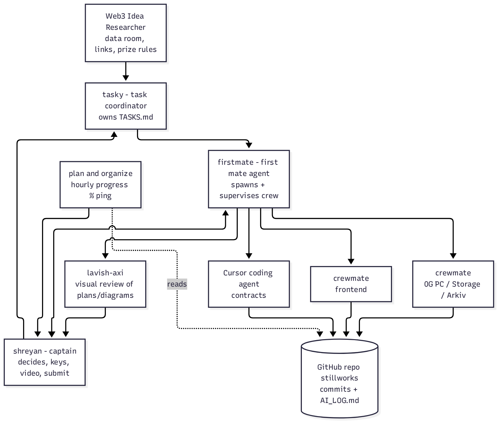
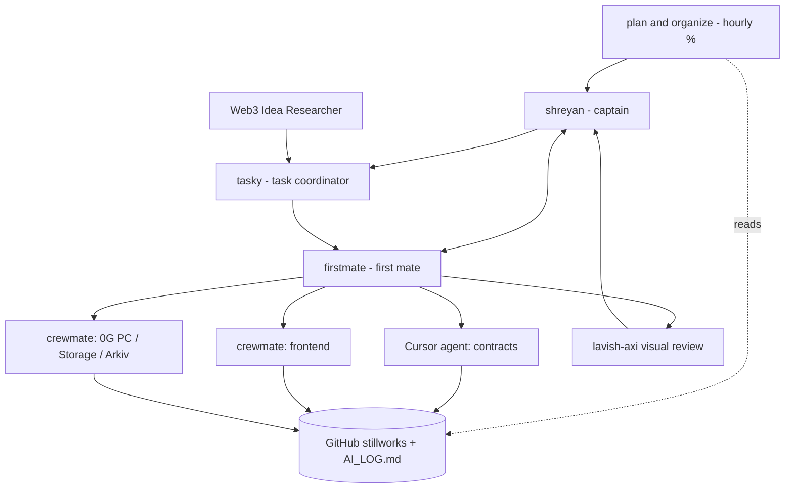
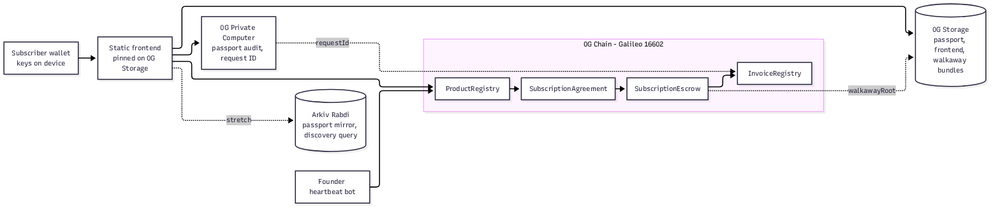
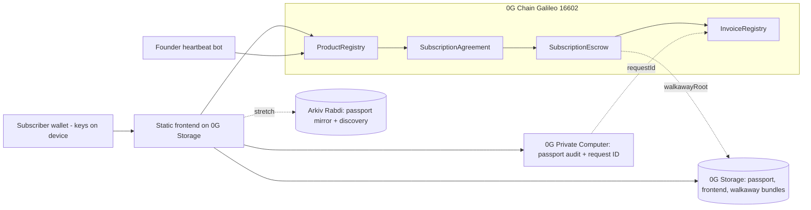

<!-- memory tiers: see the stow skill -->
# SYSTEM — who does what

## Actors
| Actor | What it is | Its job here |
|---|---|---|
| **shreyan** | Captain | Decides designs, gets keys/faucets, edits code, records video, submits |
| **tasky** | Task coordinator bot | Owns TASKS.md: one current task per lane, ticks boxes, re-plans when late |
| **Web3 Idea Researcher** | Research bot | Data room, link pack, prize rules, doc lookups, README/Arkiv drafts |
| **plan and organize** | Progress tracker bot | Hourly progress % ping (from TASKS.md ticks) |
| **Cursor coding agent** | Coding agent | Writes contracts, tests, frontend; logs every change in AI_LOG.md |
| **firstmate** | Agent distro (git clone + AGENTS.md) | You talk to one "first mate"; it spawns coding agents in tmux windows, each in its own git worktree, supervises them and hands back PRs/merges/reports. Supports Cursor Agent CLI, Claude Code, Grok, Codex, etc. as harness |
| **lavish-axi** | Local CLI + agent skill (`npx -y lavish-axi`) | Opens agent-made HTML artifacts (plans, diagrams, tables) in a local browser; you click elements, annotate, edit Mermaid diagrams, send feedback to the agent |

## How to use the two tools in this build
- **firstmate** (from Phase 2): `gh auth login && git clone https://github.com/kunchenguid/firstmate && cd firstmate`, launch a harness (e.g. Cursor Agent CLI with `--trust`, interactive). Tell it: project `stillworks`, three ship tasks — contracts, frontend, integrations (0G PC/Storage/Arkiv). Use `direct-PR` or `local-only` mode so merges need your approval. It keeps you as the only person talking to one agent.
- **lavish-axi** (at each phase gate): ask the agent "Use `npx -y lavish-axi` to show the plan/architecture for review". Click and comment instead of writing long messages. Local-first; don't use its opt-in hosted sharing for anything secret.
- **Cursor skills (global):** `C:\Users\acer\.agents\skills` — `firstmate` (entry), `lavish`, public `stow`, plus 27 firstmate crew skills (`ahoy`, `afk`, `bearings`, `project-management`, …). FM_HOME clone: `C:\Users\acer\OneDrive\Desktop\firstmate`. Stillworks registered as `FM_HOME\projects\stillworks` (junction → this folder). Invoke `/firstmate` or attach the `firstmate` skill from any project; full hooks/watcher still strongest with FM_HOME as workspace + `--trust`. <!--a:2026-11-05-->
- ⚠️ Neither tool is part of the product. Don't add them to the Stillworks repo. Log their use in AI_LOG.md like any AI help.

## Agent coordination

## Product architecture

## Runtime in one paragraph
Buyer opens the static frontend (pinned on 0G Storage, no backend). It reads listings from ProductRegistry over public RPC, fetches the passport from 0G Storage, and runs a private audit on 0G Private Computer (request ID shown). Buyer funds SubscriptionEscrow under a SubscriptionAgreement. Each period the heartbeat bot attests; escrow releases one period and InvoiceRegistry mints a receipt with the heartbeat tx and audit request ID. Missed heartbeat → refund claimable + encrypted walkaway bundle downloadable from 0G Storage. Arkiv (stretch) mirrors passports for queryable discovery.

**If 0G is removed:** there is no neutral escrow, no takedown-proof storefront or walkaway bundle, and no verifiable private audit — Stillworks becomes a directory with a Stripe button.
